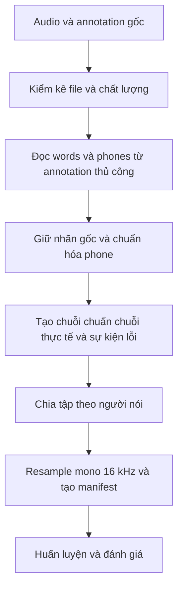
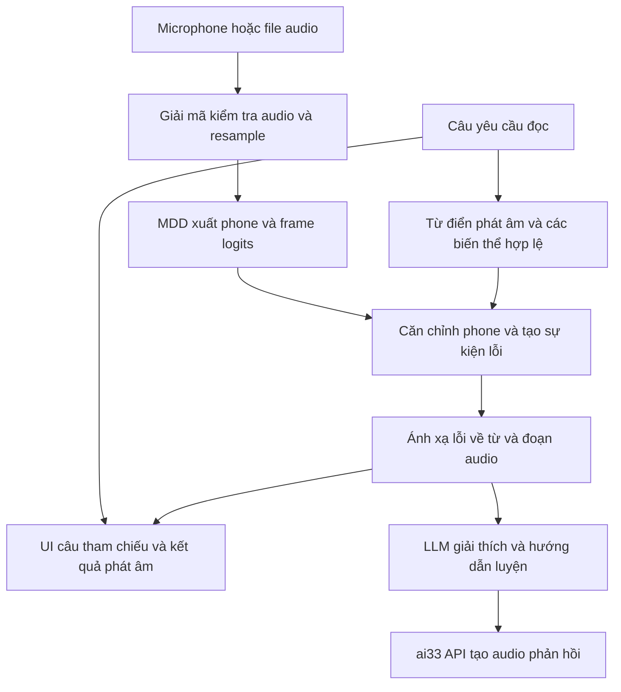

# Kế hoạch fine tune model phát hiện lỗi phát âm tiếng Anh cho người Việt

Mục tiêu là xây dựng một model Mispronunciation Detection and Diagnosis (MDD) có thể phát hiện lỗi phát âm của người Việt, kèm demo ghi âm, hiển thị câu tham chiếu và đánh dấu từ cần luyện. Phần nghiên cứu tập trung vào fine-tune duy nhất `facebook/wav2vec2-base`; LLM và TTS qua ai33 API hỗ trợ trải nghiệm demo.

Phạm vi đầu tiên là người học **đọc một câu tiếng Anh đã biết trước**. Model sau fine-tune nhận audio, dự đoán chuỗi âm thực tế; hệ thống đối chiếu với phát âm chuẩn để xác định thay âm, thiếu âm và thêm âm. Phone CTC không tự trả transcript chữ. Nhận dạng lời nói trong hội thoại tự do là phần mở rộng cần nhánh ASR hoặc model đa nhiệm được huấn luyện và đánh giá riêng; không mặc định đã có trong pipeline một model này.

Ngày đối chiếu nguồn: 20 tháng 10 năm 2026. Các thông số huấn luyện và ngưỡng nghiệm thu dưới đây là cấu hình thử nghiệm, cần điều chỉnh bằng validation và số đo trên thiết bị thực tế.

**Trạng thái setup:** đã chuẩn bị train CPU local với các preset `local_*.json`, parser, vocabulary 83 token và scorer. Toàn bộ 3.599 mẫu đã khớp checksum; smoke CPU đã hoàn thành một update kỹ thuật với Transformer/head trainable và lưu checkpoint, chưa có kết quả A/B/C khoa học. Lệnh chạy local và resume ở [TRAINING.md](TRAINING.md); [Colab](notebooks/train_mdd_colab.ipynb) là lựa chọn bổ sung.

## Kết quả cần bàn giao

| Hạng mục | Kết quả cụ thể |
| --- | --- |
| Dữ liệu | Manifest từ audio và annotation thủ công; báo cáo chất lượng; danh sách train, validation, test theo người nói |
| Model | Checkpoint MDD trước và sau thích ứng giọng Việt, vocabulary phoneme và quy tắc chuẩn hóa |
| Thực nghiệm | So sánh model nền, model thích ứng giọng Việt và model đối chứng được huấn luyện tiếp cùng số bước |
| Đánh giá | F1, precision, recall phát hiện lỗi; PER; chất lượng chẩn đoán; định vị lỗi theo từ; độ trễ |
| Demo | Ghi âm hoặc upload, câu tham chiếu, từ bị đánh dấu, âm chuẩn và âm nhận diện, phát lại đoạn nói và nghe mẫu |
| Tái lập | Cấu hình, seed, phiên bản thư viện, revision model, checksum dữ liệu và các file kết quả dự đoán |

**Câu hỏi nghiên cứu:** thêm dữ liệu người Việt ở giai đoạn fine-tune có cải thiện MDD trên một người Việt chưa xuất hiện trong huấn luyện hay không?

## Model và cách chạy local

| Thành phần | Lựa chọn ban đầu | Công việc |
| --- | --- | --- |
| MDD cần fine-tune | `facebook/wav2vec2-base` | Backbone khoảng 95 triệu tham số và head CTC dự đoán phoneme |
| Từ điển phát âm | CMUdict và bảng chuyển ARPAbet sang IPA | Tạo phoneme chuẩn, giữ các cách phát âm hợp lệ của từ |
| LLM | Gateway `https://llm.mrdnd.dev/v1`, model ID `claude-sonnet-5` | Giải thích kết quả MDD bằng JSON và tiếp tục hội thoại |
| TTS | ai33 API, cấu hình giọng Anh và Việt riêng | Đọc câu mẫu và phản hồi, không cần cài model TTS local |
| UI | Streamlit chạy local | Ghi âm, nghe lại, hiển thị câu tham chiếu và lỗi |

Chốt BASE là checkpoint duy nhất cần cho nghiên cứu MDD. Bản `base-960h` đã tải là model nhận dạng chữ tùy chọn, không thuộc pipeline mặc định. Với phone CTC, UI có thể đánh dấu từ sai nhờ câu tham chiếu mà không cần thêm model STT. Kích thước BASE được mô tả trong [paper wav2vec 2.0][p1]; checkpoint gốc tại [model card BASE][m1].

**Có thể tải model về local, fine-tune và suy luận mà không gọi dịch vụ inference.** BASE chưa có tokenizer cho tác vụ này; project phải tạo vocabulary phoneme và head CTC. Sau khi tải đủ dependencies, checkpoint và tài nguyên từ điển, nhánh MDD có thể chạy offline. TTS ai33 cần Internet khi tạo audio mới; câu mẫu đã cache có thể phát lại từ file local. LLM đã chọn chạy qua gateway API nên cần Internet để tạo phản hồi mới.

### Tải checkpoint

Script [download_models.py](scripts/download_models.py) mặc định chỉ tải BASE từ Hugging Face bằng Python standard library. Nó cố định commit SHA, ưu tiên safetensors khi repo có, chỉ tải một định dạng weights, hỗ trợ tiếp tục file tải dở và đối chiếu kích thước/checksum với metadata của Hub.

```bash
python3 scripts/download_models.py
```

Thư mục mặc định là `models/pretrained/wav2vec2-base`, có `download_revision.txt` và `download_manifest.json`. `models/pretrained/manifest.json` lưu inventory đã tải và đánh dấu `default_models` chỉ gồm BASE; checkpoint ASR đã tải vẫn nằm trong inventory tùy chọn. Kiểm tra BASE hoàn toàn local:

```bash
python3 scripts/download_models.py --verify-only
```

Chi tiết checkpoint và cách load nằm trong [hướng dẫn model local](models/pretrained/README.md). Kiểm tra download xác nhận file, cấu hình và sample rate; kiểm tra forward riêng bằng PyTorch đã thành công. BASE chưa có head phoneme đã học; vocabulary MDD 83 token đã được tạo theo inventory và quy tắc chuẩn hóa riêng của project.

Công cụ tải chính thức khác là [Hugging Face Hub][d1], có hỗ trợ `local_dir`, `revision`, `allow_patterns`. Sau fine-tune, xuất model bằng `save_pretrained` cùng vocabulary, feature extractor và bảng chuẩn hóa. Kiểm tra checkpoint cuối bằng một lần load local:

```python
from transformers import Wav2Vec2ForCTC

model = Wav2Vec2ForCTC.from_pretrained(
    "models/finetuned/vietnamese-mdd",
    local_files_only=True,
)
```

Đây là đường dẫn checkpoint **sẽ được tạo sau huấn luyện**. Cần nạp feature extractor và vocabulary đã xuất tương ứng để xử lý audio và giải mã. Có thể bật `HF_HUB_OFFLINE=1` để kiểm tra nhánh inference không cần Hub; xem [tài liệu chế độ offline][d2].

### Tài nguyên dự kiến

- Máy hiện tại dùng CPU: PyTorch CPU, FP32, batch 1, accumulation 4, 4 threads và gradient checkpointing. Không cần cài CUDA cho Intel UHD 630.
- Smoke CPU một update trên clip train 1,03 giây đã pass, peak RSS khoảng 2,24 GiB; chưa benchmark toàn bộ 2.000 update của A hoặc clip dài nhất.
- Đang còn khoảng 50 GiB disk khi setup; dự trù khoảng 1,4 GiB mỗi run cho best/checkpoint có AdamW, cộng vùng tạm. Resample lúc load, không nhân bản toàn bộ WAV.
- Nếu chuyển sang GPU, preset CUDA/FP16 và notebook vẫn được giữ. Đo tài nguyên MDD riêng với độ trễ API LLM/TTS.

## Dataset và cách tải về

### L2 ARCTIC là dữ liệu huấn luyện chính

Dùng bản phát hành v5.0 và phần scripted có annotation thủ công. Các mã người Việt là `HQTV`, `PNV`, `THV`, `TLV`. Kiểm kê trực tiếp các archive đã tải trong project xác nhận bốn người này có tổng 4.528 file audio và **600 câu có nhãn lỗi thủ công**; toàn corpus có 3.599 câu annotated. Phần `textgrid/` là forced alignment, còn `annotation/` là nhãn thủ công. [Tài liệu dataset][a1]

Cách lấy dữ liệu:

1. Vào [trang phát hành chính thức][a2].
2. Đọc điều kiện CC BY-NC 4.0; điền tên, email và đơn vị để nhận liên kết tải.
3. Tải archive về `data/downloads/l2_arctic/`, giữ nguyên bản gốc và tính SHA-256.
4. Giải nén vào `data/raw/l2_arctic/`, ghi lại version, ngày tải và nội dung license.

Corpus được cung cấp qua liên kết gửi email, nên không giả định có một URL tải trực tiếp cố định. Dữ liệu có thể lưu và xử lý local sau khi được cấp quyền truy cập. Việc dùng cho sản phẩm thương mại cần quyền phù hợp với điều kiện phát hành. [Hướng dẫn truy cập và license][a2]

### Speech Accent Archive là tập đánh giá bổ sung

[Nhóm Vietnamese][s1] hiện liệt kê 40 bản ghi. Có các mẫu kèm phiên âm IPA, nhưng cần kiểm kê số bản có phiên âm sử dụng được trước khi chốt tập đánh giá. Mỗi người đọc cùng một đoạn ngắn; nguồn này bổ sung sự đa dạng người nói, không thay thế nhiều giờ dữ liệu có nhãn.

Tải audio và các phiên âm có sẵn từ OSF qua [trang download chính thức][s2]. Dữ liệu phát hành theo CC BY-NC-SA 4.0. Lưu vào `data/raw/speech_accent_archive/`; tạo danh sách những mẫu đủ nhãn, chuẩn hóa IPA và kiểm tra thủ công trước khi đánh giá MDD.

**Giữ tập này ngoài train và validation** nếu sử dụng làm kiểm tra khả năng tổng quát hóa. Chốt tập mẫu theo chất lượng audio và nhãn trước khi xem kết quả model; báo cáo số người, thời lượng, số phone và các mẫu bị loại.

### Mở rộng dữ liệu người Việt sau MVP

Thu pilot 30–50 người, mỗi người 40–60 câu; cân đối trình độ, vùng giọng và thiết bị. Ưu tiên ghi lại cách đọc tự nhiên. Dùng audio, câu yêu cầu đọc, phiên âm từ thực tế và annotation lỗi phoneme làm dữ liệu riêng biệt.

Tập test phải được chuyên gia hoặc người được đào tạo kiểm tra độc lập; kiểm tra chéo một phần dữ liệu để đo mức đồng thuận nhãn. Chia người nói trước khi chia câu. Pilot này là hướng mở rộng khi cần độ bao phủ tốt hơn bốn người Việt của L2-ARCTIC, chưa phải điều kiện hoàn thành demo ban đầu.

## Pipeline chuẩn bị dữ liệu



Các bước thực hiện:

1. Ghép audio, transcript và annotation theo `speaker_id` và `utterance_id`; phát hiện file thiếu, hỏng, trùng, hoặc sai sample rate.
2. Đọc tier `words` và `phones` từ annotation thủ công; giữ cả chuỗi nhãn thô và thời gian để có thể kiểm tra lại.
3. Xây bảng chuẩn hóa có version. Bỏ dấu nhấn số nếu chỉ đánh giá lỗi âm vị; giữ phân biệt các phone cần chẩn đoán. `TH` phải là một token, không bị tách thành `T` và `H`.
4. Tạo target CTC từ âm thực tế; giữ sự kiện lỗi gốc để chấm MDD. Phoneme bị xóa không xuất hiện trong target; phoneme được thêm phải xuất hiện.
5. Chuyển audio thành mono 16 kHz bằng resampling thực sự, không chỉ sửa metadata. Giữ audio gốc; tránh cắt mất phụ âm cuối bằng VAD quá mạnh.
6. Kiểm tra số mẫu, thời lượng, phân bố phone, loại lỗi và tỷ lệ nhãn không rõ theo từng người nói và split.

Ví dụ diễn giải nhãn theo [quy ước chính thức][a1]:

| Nhãn gốc | Phoneme chuẩn | Target âm thực tế | Sự kiện lỗi |
| --- | --- | --- | --- |
| `TH` | `TH` | `TH` | correct |
| `TH,T,s` | `TH` | `T` | substitution |
| `TH,sil,d` | `TH` | không phát token | deletion |
| `sil,AH,a` | không có phone chuẩn | `AH` | addition |

Với `err`, dùng token âm không xác định riêng; vẫn giữ nhãn phát hiện lỗi nhưng loại khỏi phép chấm yêu cầu biết chính xác âm thay thế. Với `*`, giữ dấu lệch âm trong nhãn và vocabulary, ví dụ `R*`, thay vì tự động đổi thành `R`. Quy tắc này tạo một inventory mở rộng; kết quả PER phải ghi rõ inventory, không so trực tiếp với PER của paper dùng bộ 39 phone.

Chốt vocabulary từ inventory công bố và quy tắc biến thể đã định nghĩa, không mở rộng vocabulary bằng nhãn test. Thống kê phone ngoài inventory là OOV và công bố cách xử lý. Bộ chấm đọc `gold_error_events` gốc để tránh mất lỗi khi chuẩn hóa phone.

Không lấy phát âm chuẩn sinh từ transcript làm target âm thực tế cho toàn bộ 4.528 câu người Việt: cách đó có thể dạy model bỏ qua chính lỗi cần phát hiện. Dữ liệu chưa có nhãn lỗi chỉ được đưa vào một thí nghiệm riêng nếu triển khai pseudo-label hoặc học tự giám sát.

Manifest cần có các trường:

```text
utterance_id, speaker_id, native_language, dataset_version
audio_path, audio_sha256, sample_rate, duration
prompt_text, annotation_path, annotation_is_manual
canonical_phones, perceived_phones, raw_phone_labels
word_intervals, phone_intervals, gold_error_events
split, fold, normalization_version
```

`gold_error_events` phải thể hiện được vị trí phone chuẩn hoặc khe giữa các phone, loại lỗi và âm thực tế nếu biết. Addition cần vị trí ở khe; không ép nó vào một phone chuẩn không tồn tại.

Trước train, kiểm tra thủ công các trường hợp đúng, thay âm, xóa âm, thêm âm, phone lặp, `err` và `*`. Cố định quy tắc căn chỉnh khi có nhiều nghiệm edit-distance bằng nhau; đối chiếu bộ chấm của [tác giả Peng 2021][c1] trước khi triển khai chỉ số benchmark.

## Chia dữ liệu để đánh giá người Việt

Phân tích cập nhật ở [DATA_SPLIT.md](docs/DATA_SPLIT.md) và [audit dữ liệu](data/generated/setup/split_audit.md). Thiết kế v1 dưới đây đang được code sử dụng. Đề xuất v2 giữ 2/1/1 người, cân đối một nam/một nữ trong target train của mọi fold, lưu riêng và chưa kích hoạt; không tự thay manifest đã khóa.

Protocol chính là đánh giá thích ứng giọng Việt, được thiết kế riêng cho project. Nó không phải phép tái lập nguyên trạng split trong paper Peng 2021.

**Có chia train, validation và test, nhưng không xáo trộn tất cả câu để lấy tỷ lệ 7/3 hoặc 8/2.** Đơn vị chia chính là người nói. Nếu câu của cùng một người xuất hiện trong cả train và test, kết quả không còn đo đúng khả năng xử lý một người Việt mới.

Với 20 người không phải người Việt, giữ cố định năm người làm `source_dev`: `SKA`, `LXC`, `RRBI`, `HJK`, `ERMS`, tương ứng năm nhóm L1. Mười lăm người còn lại làm `source_train`. Chỉ dùng các câu annotated; kiểm kê và xác nhận metadata từ archive trước khi khóa manifest.

Với bốn người Việt, tạo bốn fold:

| Fold | Vietnamese train | Vietnamese validation | Vietnamese test |
| --- | --- | --- | --- |
| 1 | THV, TLV | PNV | HQTV |
| 2 | HQTV, TLV | THV | PNV |
| 3 | HQTV, PNV | TLV | THV |
| 4 | PNV, THV | HQTV | TLV |

Mỗi fold có khoảng 300 câu Việt cho train, 150 validation và 150 test trước các bước kiểm tra chất lượng. Người test không xuất hiện trong train, validation, pseudo-label hoặc chọn tham số của fold đó.

Trong nhóm Việt, tỷ lệ mỗi fold là 50% train, 25% validation, 25% test theo người nói; đây là hệ quả của việc chỉ có bốn người, không phải tỷ lệ cần áp dụng cho mọi dataset. Validation dùng chọn checkpoint và tham số; test dùng báo cáo cuối sau khi đã khóa cấu hình. Khi có nhiều người nói hơn, có thể chia 70/15/15 hoặc 80/10/10 theo người nói và bảo đảm từng tập có đủ đa dạng.

Danh sách mẫu và checksum gốc được cố định tại [data/protocol/l2arctic-v1](data/protocol/l2arctic-v1/protocol.json). [splits.json](data/protocol/l2arctic-v1/splits.json) lưu danh sách ID cụ thể cho mỗi vai trò; [manifest.jsonl](data/protocol/l2arctic-v1/manifest.jsonl) lưu đường dẫn và SHA-256 của audio, annotation và transcript. Script [freeze_l2arctic_protocol.py](scripts/freeze_l2arctic_protocol.py) tạo bộ này và từ chối ghi đè phiên bản đã tồn tại. Nhãn phone đã được parse ở `data/processed/l2arctic-v1/`; kết quả model chỉ có sau khi train.

Kiểm kê bộ hiện tại có 3.599 câu annotated, tổng thời lượng khoảng 3,66 giờ: 2.249 câu nguồn train, 750 câu nguồn validation và 600 câu Việt dùng theo bốn fold. Các số này lấy từ file local đã kiểm kê, không phải kết quả chạy model.

Khi chạy cross-validation, người test của một fold có thể thuộc train của fold khác; các model và quyết định chọn checkpoint giữa các fold phải độc lập theo protocol đã khóa. Không dùng kết quả của một fold để chỉnh tham số rồi báo các fold đã xem như test độc lập.

L2-ARCTIC có nhiều câu mẫu lặp giữa người nói. Protocol này chủ yếu đo tổng quát hóa sang **người nói mới**. Muốn kết luận về câu chưa thấy, cần thêm đánh giá giữ riêng cả người nói và prompt, hoặc dùng tập ngoài có nội dung khác.

Audit xác nhận cả 150/150 mã câu test ở mỗi fold đã xuất hiện trong source train và Vietnamese train. V1 fold 2 train hai người nam, fold 4 train hai người nữ; [phương án v2](data/proposals/l2arctic-v2-balanced/splits.json) loại bớt bất cân đối metadata này với cùng ngân sách. Chọn protocol trước khi chạy test, không chọn lại bằng F1 test.

## Thí nghiệm fine tune

| Mã | Khởi tạo và dữ liệu | Vai trò |
| --- | --- | --- |
| A | BASE với head CTC mới, train trên `source_train` | Model MDD nền chưa dùng người Việt |
| B | Từ A, train tiếp trên Vietnamese train của từng fold và dữ liệu nguồn | Model thích ứng giọng Việt |
| C | Từ cùng checkpoint A, train tiếp chỉ trên `source_train`, cùng số bước với B | Đối chứng cho tác động của việc huấn luyện lâu hơn |
| D tùy chọn | Từ A, train tiếp chỉ trên Vietnamese train | Đo ảnh hưởng của việc trộn lại dữ liệu nguồn |

So sánh **B với C** là phép kiểm tra chính về lợi ích của dữ liệu người Việt; A cho biết mức thay đổi so với model nền. Thực hiện cùng preprocessing, decoder và bộ chấm ở mọi thí nghiệm.

Cấu hình khởi đầu:

| Tham số | A | B và C |
| --- | --- | --- |
| Đầu ra và loss | Phoneme CTC | Giữ nguyên vocabulary và CTC |
| CNN feature encoder | Freeze | Freeze |
| Transformer và CTC head | Fine-tune cùng nhau trong baseline hiện tại | Fine-tune |
| Learning rate | Backbone `3e-5`, head mới `3e-4` | Backbone `1e-5`, head `1e-4`, chọn thay đổi bằng dev |
| Optimizer | AdamW | AdamW |
| Batch vật lý | 1 câu, lấy mẫu ngẫu nhiên có hoàn lại | Giữ cách tính batch như A |
| Gradient accumulation | 4, tương đương 4 câu mỗi update | Như A |
| Precision | FP32 trong preset local; CUDA/FP16 trong preset Colab | Như A |
| Ngân sách thử nghiệm đầu | 2.000 optimizer update, đánh giá mỗi 250 | 400 update, đánh giá mỗi 100 |
| Chọn checkpoint | F1 trên `source_dev` | F1 trên Vietnamese validation của fold |

Các giá trị này khớp cấu hình JSON local và Colab về ngân sách/LR, chưa được tối ưu bằng thực nghiệm; baseline chưa có pha warm-up head riêng. Với B, lấy mẫu khoảng 50% Việt và 50% nguồn có hoàn lại. C dùng cùng batch, learning rate, số update và tần suất đánh giá. Ghi lại số giây audio thực tế. Nếu thay warm-up hoặc lịch learning rate, tạo thí nghiệm mới và khóa bằng validation.

Chạy thử trên một tập nhỏ để xác nhận CTC loss hữu hạn, target đúng, gradient hoạt động và model có thể học; sau đó mới chạy đủ ngân sách. Bắt đầu seed 42. Khi pipeline ổn, chạy thêm seed 123 và 2026, giữ nguyên protocol.

Với một seed, cần một lượt A dùng chung và tám lượt tiếp tục B/C cho bốn fold. Với ba seed là 27 lượt tổng cộng. Các lượt dùng chung A không được dùng dữ liệu Việt ở giai đoạn chọn checkpoint nguồn.

Trước khi chấm test, khóa learning rate, tỷ lệ trộn, preprocessing, decoder và quy tắc xử lý nhãn. Nếu B không cải thiện, báo cáo kết quả đó và phân tích lỗi; không đổi tập test để đạt mục tiêu.

## Lưu bằng chứng trước và sau fine tune

“Trước” trong thí nghiệm thích ứng giọng Việt là checkpoint A đã học nhận diện phone trên dữ liệu nguồn. BASE tải nguyên bản chưa có head phoneme CTC đã học; so sánh với một head khởi tạo ngẫu nhiên chưa đủ để kết luận về lợi ích của việc thích ứng giọng Việt.

Quy trình đánh giá cố định:

1. Khóa manifest, split, vocabulary, normalization, bộ chấm và kế hoạch thí nghiệm trước khi xem kết quả test.
2. Chạy A trên các audio test đã khóa để lưu dự đoán trước thích ứng. Lưu bằng quy trình tự động và chưa dùng kết quả test để chỉnh huấn luyện. Các lượt thử trong quá trình phát triển chỉ xem validation.
3. Fine-tune B và chạy đối chứng C từ cùng A. Chọn checkpoint B/C bằng validation, không bằng test. Khóa mọi lựa chọn trước khi đánh giá cuối.
4. Chạy B/C trên đúng các ID và nội dung audio của bước 2; giữ cùng quy tắc giải mã và chấm. Xuất số liệu và so sánh cặp A/B/C sau khi hoàn thành các lượt đã định trước.
5. Giữ cả kết quả tốt hơn, không đổi và kém đi. Ví dụ nghe minh họa phải có quy tắc chọn hoặc có cả trường hợp hồi quy; kết luận dựa trên toàn bộ tập test.

Các lần đánh giá model cuối phải cùng file hash, cùng normalization, câu tham chiếu và scorer version. Metrics MDD không phụ thuộc câu trả lời LLM hoặc giọng TTS.

Mỗi lượt có một `run_id` riêng và lưu các artifact:

```text
runs/<run_id>/
  run_manifest.json           # stage A/B/C, fold, seed, checkpoint hash
  config.json                # learning rate, batch, data sampling, decoder
  environment.json           # Python, package versions, CPU/GPU/CUDA
  data_protocol.json         # manifest/splits/vocabulary/scorer hashes
  checkpoint/                # weights; optimizer/scheduler/RNG nếu cần resume
  training_log.jsonl          # step, loss, validation metrics
  predictions_test.jsonl     # mọi mẫu test, kể cả lỗi xử lý hoặc không kết luận
  metrics_test.json           # counters, denominators, metrics và coverage
  metrics_by_speaker.csv
  metrics_by_error_type.csv
  examples/                  # ID và đoạn nghe minh họa được chọn

reports/comparison/<comparison_id>/
  paired_predictions.jsonl    # ghép A/B/C theo cùng utterance_id
  metrics_comparison.csv
  improvements.jsonl
  regressions.jsonl
  comparison_manifest.json   # run IDs và checksum các artifact đầu vào
```

Mỗi dòng dự đoán test cần có: `utterance_id`, `speaker_id`, `audio_sha256`, nhãn chuyên gia và phiên bản nhãn, phone thực tế dự đoán, sự kiện lỗi, trạng thái xử lý, thời gian inference và checkpoint ID. Các bộ đếm `TA/FR/FA/TR`, `CD/DE`, `S/D/I/N` và số trường hợp bị loại khỏi từng phép chấm được lưu để tính lại metrics. Logits có thể lưu nén cho một tập debug cố định; không bắt buộc nhân bản logits của mọi audio cho mọi run.

Giữ audio và annotation gốc tại đường dẫn trong manifest, kiểm tra checksum trước khi dùng trên Colab. Không cần copy toàn bộ audio vào mỗi run. Khi tạo dữ liệu 16 kHz, lưu checksum và cấu hình resample của bản dẫn xuất. Dữ liệu chia sẻ giữa local và Colab phải có cùng nội dung; lưu checkpoint định kỳ ra nơi bền vững và giữ đủ trạng thái để resume.

Bảng so sánh cần có stage, fold, seed, số người, số audio, F1, precision, recall, FAR, FRR, PER, DER và latency. Báo cả delta B−A và B−C theo từng người; ghi delta F1 bằng điểm phần trăm. Dùng cùng những mẫu hợp lệ khi phân tích cặp và báo riêng mọi lỗi xử lý để việc loại mẫu không làm điểm tăng giả tạo.

Một kết luận hợp lệ có dạng: “Trên protocol và nhóm người nói được mô tả, B thay đổi F1 bao nhiêu so với A/C, đổi FRR thế nào và kết quả có nhất quán giữa fold/seed hay không.” Không dùng điểm từ paper, JSON minh họa hoặc vài bản ghi demo làm kết quả thực nghiệm của project.

## Chỉ số đánh giá

### Phát hiện lỗi phoneme là chỉ số chính

Định nghĩa tại các vị trí phone và khe chèn đã căn chỉnh:

- `TA`: phát âm đúng và hệ thống chấp nhận.
- `FR`: phát âm đúng nhưng hệ thống báo lỗi.
- `FA`: có lỗi nhưng hệ thống bỏ sót.
- `TR`: có lỗi và hệ thống phát hiện.

```text
Precision = TR / (TR + FR)
Recall    = TR / (TR + FA)
F1        = 2 * TR / (2 * TR + FR + FA)
FAR       = FA / (FA + TR)
FRR       = FR / (TA + FR)
```

FAR cho biết mức bỏ sót lỗi; FRR cho biết mức báo sai đối với âm đúng. Các định nghĩa nền tảng có trong [Peng 2021][p3]. Bộ chấm phải chốt cách đếm insertion và các alignment mơ hồ trước khi xuất bảng kết quả. Mẫu không đủ âm thanh cần được báo riêng; không bỏ âm thầm những mẫu model làm sai.

### Các chỉ số bổ sung

| Chỉ số | Đo gì | Cách chấm |
| --- | --- | --- |
| PER | Nhận diện chuỗi phone thực tế | `(S + D + I) / N` so với phiên âm thực tế; ghi rõ inventory và xử lý `err`, `*` |
| F1 theo loại lỗi | Thay, thiếu, thêm âm | Báo precision, recall, F1 và số lượng mẫu từng loại |
| DER | Chẩn đoán sai trong các lỗi đã bắt được | `DE / (CD + DE)`; CD là chẩn đoán đúng, DE là chẩn đoán sai, trên các trường hợp gold đủ thông tin |
| F1 định vị lỗi theo từ | UI đánh dấu đúng từ hay không | Từ có ít nhất một lỗi phone là positive; chốt cách gắn insertion ở biên từ |
| WER của STT, chỉ khi mở rộng ASR | Transcript có đúng từ thực sự được nói không | Ngoài phép chấm MVP phone CTC; cần nhánh nhận dạng chữ và transcript từ được kiểm tra thủ công |
| RTF | Tốc độ xử lý audio | Thời gian xử lý / thời lượng audio; ghi rõ tính cho MDD hay toàn pipeline |
| Latency p50 và p95 | Thời gian người dùng chờ | Từ lúc kết thúc ghi âm đến khi hiện lỗi trên câu tham chiếu; đo LLM và TTS riêng |
| Bộ nhớ | Khả năng chạy local | Peak VRAM khi train và inference; ghi batch, độ dài audio và thiết bị |

Pipeline mặc định không xuất transcript chữ nên không chấm WER. Khi bổ sung ASR, nếu dùng câu mẫu làm reference cho WER mà chưa kiểm tra người học có đọc khác từ hay không, phải gọi đó là **WER so với prompt**, chưa coi là WER ASR chuẩn. Lỗi nhận dạng từ và lỗi phát âm là hai phép đo khác nhau.

DER chỉ chấm trên các lỗi có đủ nhãn để biết chẩn đoán đúng; công bố số trường hợp `err` bị loại khỏi phép chấm này. Luôn đọc DER cùng recall: một model chỉ phát hiện vài lỗi dễ có thể có DER thấp nhưng bỏ sót nhiều lỗi.

Báo cả kết quả gộp các dự đoán test của bốn fold và trung bình theo người nói, kèm từng fold và từng seed. Bốn người Việt chưa đủ để đưa ra kết luận mạnh cho toàn bộ người Việt; nếu ước lượng độ bất định, resample theo người nói thay vì coi mọi phone là mẫu độc lập.

### Tiêu chí hoàn thành

- Có checkpoint xuất local và nạp lại được khi chặn truy cập Hub.
- Có đủ dự đoán và metrics của A, B, C trên bốn fold; không có người test trong dữ liệu học của fold tương ứng.
- Mục tiêu thử nghiệm là B cao hơn C khoảng 3 điểm phần trăm F1 trung bình và không tăng FRR quá 2 điểm phần trăm. Nếu không đạt, vẫn bàn giao kết quả và phân tích nguyên nhân; đây không phải mức đã được paper bảo đảm.
- UI chạy được với ghi âm mới, trình bày lỗi từ kết quả model thực và xử lý được audio rỗng, quá nhỏ hoặc không giải mã được.
- Mục tiêu hiệu năng ban đầu là p95 dưới 2 giây cho clip khoảng 5 giây trên GPU được chọn, chưa tính LLM/TTS; phải benchmark trước khi cam kết.

## Pipeline inference và demo



Quy trình xử lý một lượt đọc:

1. Nhận audio, câu mẫu và mã phiên. Ghi âm trên trình duyệt có thể ở sample rate khác 16 kHz nên backend luôn kiểm tra và resample.
2. Chạy duy nhất model MDD đã fine-tune từ BASE để lấy logits phoneme; câu hiển thị là câu tham chiếu người dùng đã chọn hoặc nhập.
3. Giải mã CTC thành phone thực tế bằng greedy decoding ban đầu. Khi giải mã, collapse các token lặp liền kề rồi bỏ blank; token lặp bị ngăn bởi blank vẫn là hai phone.
4. Đối chiếu chuỗi thực tế với phone chuẩn, có xét biến thể phát âm hợp lệ; tạo substitution, deletion, addition.
5. Gắn lỗi vào từ dựa trên phone chuẩn của từng từ. Dùng frame CTC để ước lượng đoạn âm; không dùng ranh giới thủ công của test làm đầu vào khi suy luận.
6. Hiển thị lỗi trên câu tham chiếu trước; LLM tạo hướng dẫn từ cấu trúc lỗi, sau đó adapter ai33 nhận text theo ngôn ngữ, chờ task hoàn tất và tải audio để UI phát lại.

Timestamp CTC là ước lượng. Với deletion, có thể chỉ hiển thị vị trí trong từ hoặc khoảng lân cận; không tạo timestamp chính xác cho một âm không được phát ra. Nếu không định vị được đoạn đáng tin cậy thì cho nghe lại cả từ hoặc cả câu.

UI tối thiểu:

- Chọn câu mẫu hoặc nhập câu tham chiếu riêng để đọc.
- Ghi âm hoặc upload, nghe lại bản ghi và bấm phân tích.
- Hiển thị câu tham chiếu và chuỗi phone dự đoán; đánh dấu từ cần luyện bằng màu kèm nhãn chữ. Không gắn nhãn câu tham chiếu là transcript STT.
- Bấm vào từ để xem âm chuẩn, âm nhận diện, loại lỗi và nghe lại đoạn nói; có nút nghe mẫu và thu lại.
- Có thể chọn checkpoint nền và checkpoint đã thích ứng để minh họa trước/sau trên cùng bản ghi. Dùng đúng một cặp model của fold đã xác định cho demo so sánh.

Ví dụ **minh họa**, không phải kết quả benchmark:

```text
Câu mẫu          I think this is useful.

Từ cần luyện     think
Âm chuẩn         /θ/
Âm nhận diện     /t/
Loại lỗi         substitution

[Nghe đoạn của bạn] [Nghe mẫu] [Thu lại]
```

Không tự quy đổi xác suất CTC thành “độ chính xác phát âm 95%”. Nếu cần điểm hoặc confidence cho UI, phải thiết kế và hiệu chỉnh riêng trên validation, đồng thời báo coverage khi hệ thống từ chối kết luận.

Khi mở rộng hội thoại tự do, cần thiết kế nhánh nhận dạng chữ hoặc model đa nhiệm rồi cho người dùng xác nhận câu dự định nói trước khi chẩn đoán phát âm. Một phát âm có thể tương ứng nhiều từ hợp lệ; nếu chỉ nghe audio thì không luôn xác định được người học định nói từ nào.

Đầu ra nội bộ của MDD có `reference_text`, `asr_text=null` trong MVP, danh sách lỗi với `word_index`, `expected_phone`, `observed_phone`, `type`, khoảng thời gian nếu có và trạng thái đủ bằng chứng. LLM giải thích các trường đó; việc phát hiện lỗi vẫn do nhánh âm học thực hiện.

## Định dạng cho LLM và kiểm tra phản hồi

Các artifact định dạng đã có trong [contracts](contracts/README.md): schema [MDD assessment](contracts/mdd_assessment.schema.json), schema [LLM feedback](contracts/llm_feedback.schema.json), hai [ví dụ JSON](contracts/examples/assessment.json) và [prompt phản hồi](prompts/pronunciation_feedback.txt). Các ví dụ có `data_kind=synthetic_example`; chúng không phải output thực của model hoặc LLM.

LLM chính dùng endpoint `https://llm.mrdnd.dev/v1/chat/completions` và model ID `claude-sonnet-5`. Adapter [scripts/llm_client.py](scripts/llm_client.py) đã có chế độ chat, tạo feedback JSON, kiểm tra contract, thử sửa một lần và fallback về lời nhắc mẫu. Cấu hình/key nằm trong `.env` local qua các biến `LLM_*`; hướng dẫn ở [README.md](README.md). Kiểm tra kết nối thật bằng key mới đã trả lời được bằng tiếng Việt; một feedback trên assessment minh họa đã qua contract sau một lần sửa locale TTS, lưu ở `data/generated/llm/feedback_checked.json` cùng metadata. Kết quả này chưa chứng minh độ tin cậy trên tập kiểm tra. Thông tin model trả về được lưu riêng với model ID đã yêu cầu, không tự suy ra nhà cung cấp thực tế từ tên alias.

Luồng dữ liệu khi triển khai:

```text
logits và phone từ model
    → adapter căn chỉnh và ánh xạ lỗi về từ
    → JSON MDD đã validate
    → LLM tạo feedback JSON
    → validate schema và liên kết error_id
    → UI giữ lỗi từ MDD, hiển thị hướng dẫn từ LLM
    → TTS nhận text theo từng ngôn ngữ
```

Tên trường được chốt trong schema là `expected_phone`, `observed_phone` và `type` cho mỗi lỗi. `word_index` là chỉ mục bắt đầu từ 0 trong danh sách từ tham chiếu; ID lỗi dùng để liên kết lời giải thích. Xóa âm có `observed_phone=null`, thêm âm có `expected_phone=null`; timestamp và confidence chưa xác định cũng là `null`, không điền số giả.

Chạy kiểm tra hai ví dụ bằng:

```bash
python3 scripts/validate_contracts.py contracts/examples/assessment.json contracts/examples/feedback.json
```

Script kiểm tra schema và liên kết giữa hai tài liệu. LLM được phép giải thích các lỗi có sẵn và đề xuất luyện tập, không tự thêm lỗi, đổi nhãn hoặc tạo confidence. Không đưa gold test labels cho LLM ở đường inference. Nếu JSON sai, backend thử tạo lại tối đa một lần rồi dùng lời hướng dẫn mẫu; UI không phụ thuộc LLM để đánh dấu từ sai.

Nếu `status` là `insufficient_audio` hoặc `uncertain`, hướng dẫn thu lại; không đưa ra chẩn đoán. Với `errors=[]`, chỉ nói chưa phát hiện lỗi, không khẳng định phát âm hoàn hảo. Schema và script chưa kiểm chứng tính đúng của nội dung ngữ âm: khi nối LLM đã chọn, cần đánh giá riêng tỷ lệ JSON hợp lệ, lỗi tham chiếu ID, lời giải thích bịa thêm lỗi và độ đúng của hướng dẫn trên một tập kiểm tra thủ công. Dùng validation để chỉnh prompt; giữ một tập riêng cho báo cáo cuối.

## TTS qua ai33 API

Tài liệu nền tảng ở [TTS từ văn bản đến âm thanh](papers/tts/README.md), kèm các paper về acoustic model, vocoder, codec language model, flow matching và framework đa tác vụ. Tài liệu phân biệt input/output của model neural với giao diện API dịch vụ.

Chốt dùng **ai33 API** để giảm phần cài đặt local. Adapter có sẵn tại [scripts/ai33_tts.py](scripts/ai33_tts.py), dùng Python standard library. Hướng dẫn cấu hình và lệnh chạy ở [README.md](README.md); API key điền vào `.env` local từ [.env.example](.env.example), không gửi key cho LLM hoặc frontend.

Cấu hình `AI33_VOICE_EN` cho câu mẫu tiếng Anh Mỹ và `AI33_VOICE_VI` cho giải thích tiếng Việt. Voice tiếng Việt `edge_vi-VN-HoaiMyNeural` lấy từ ví dụ đã cung cấp; giọng tiếng Anh cần lấy ID khả dụng từ tài khoản. `--locale` chọn cấu hình giọng, không tự đổi accent của voice đã chọn. Các âm IPA riêng lẻ cần audio mẫu đã kiểm tra hoặc nội dung hướng dẫn phù hợp, không gửi chuỗi `/θ/` như văn bản thông thường và mặc định đó là âm chuẩn.

Luồng thực hiện:

1. Backend validate JSON phản hồi LLM và lấy từng `tts_segments[].text` cùng `language`.
2. Chọn giọng đúng ngôn ngữ rồi gọi `POST /v3/text-to-speech` với `text`, `voice_id`, `speed`, xác thực bằng `xi-api-key`.
3. Lưu `task_id` ngay sau khi nhận. Poll `GET /v1/task/{task_id}` có timeout, tải audio khi hoàn tất; không tự retry POST để tránh tạo trùng tác vụ. [Tài liệu nhà cung cấp][t4]
4. Lưu audio và receipt không chứa key trong `data/generated/tts/ai33/`. Cache theo host, text, locale, voice và speed; receipt có SHA-256 để kiểm tra audio được dùng lại. Nếu đã nhận task ID nhưng polling/tải lỗi, lần chạy lại tiếp tục task cũ.
5. UI phát audio đã tải. Hiển thị câu tham chiếu và lỗi MDD trước, không chờ TTS mới hiện kết quả.

Endpoint `/v3/text-to-speech/dialogue` trong curl đã cung cấp dành cho nhiều người nói; demo hiện tại gọi một giọng cho từng đoạn. `with_transcript` không được dùng làm nhãn phát âm hoặc ground truth. Base URL mặc định là `https://api.ai33.pro` theo yêu cầu; public guide hiện ghi `https://api.openspeaker.ai`, nên host được cấu hình qua `AI33_BASE_URL`, không tự đổi host. [Hướng dẫn API][t3]

Public OpenAPI chỉ công bố schema response tổng quát; parser task hiện hỗ trợ các envelope phổ biến và báo lỗi nếu cấu trúc không nhận diện được. **Chưa có key trong môi trường nên chưa kiểm chứng tích hợp với tài khoản thật.** Các test HTTP giả lập đã có tại [tests/test_ai33_tts.py](tests/test_ai33_tts.py). Bước nghiệm thu đầu tiên sau khi cấu hình key là gọi một câu, xác nhận task hoàn tất, audio tải được và nghe đúng giọng. [Public OpenAPI][t5]

Kiểm tra chất lượng câu mẫu sau khi chọn voice:

1. Chốt 60 câu luyện bao phủ các cặp âm và lỗi cần dạy, gồm từ đơn, minimal pair, phụ âm cuối và câu có trọng âm.
2. Sinh audio bằng giọng Anh Mỹ đã chọn. Lưu file gốc và SHA-256 để nghe lại đúng bản.
3. Hai người đánh giá có chuyên môn nghe theo thứ tự xáo trộn. Chấm độ đúng của phone mục tiêu và trọng âm riêng với độ tự nhiên/dễ nghe.
4. Báo số phone đúng trên tổng phone mục tiêu, tỷ lệ câu có lỗi cần sửa, độ tự nhiên thang 1–5, latency p50/p95, lỗi tác vụ và chi phí thực tế. WER hoặc điểm từ MDD chỉ là kiểm tra phụ.
5. Ghi voice ID, locale, speed và backend thực nếu nhà cung cấp trả thông tin; nếu không thì ghi `not_reported`. Cache bản câu mẫu đã kiểm tra để tránh thay đổi audio giữa các lượt demo.

ai33/OpenSpeaker cung cấp nhiều nguồn giọng nhưng đầu ra có thể do model OpenSpeaker tạo theo hướng dẫn công khai của họ; cần nghe đánh giá audio thực, không xếp chất lượng chỉ theo tên nguồn giọng. [Hướng dẫn API][t3] TTS không tham gia tính F1 MDD và không tạo ground truth cho thí nghiệm fine-tune.

## Thứ tự triển khai

Lịch dự kiến cho một người là khoảng 10 ngày làm việc sau khi có quyền truy cập dataset và GPU. Thời gian annotate tập ngoài hoặc thu thêm dữ liệu có thể kéo dài hơn.

| Giai đoạn | Việc làm | Điều kiện chuyển bước |
| --- | --- | --- |
| Ngày 1 | Chuẩn bị môi trường, tải model, đăng ký và tải dataset, ghi revision/checksum | Model load local được, có archive và license |
| Ngày 2 | Parser annotation, chuẩn hóa phone, kiểm kê và khóa split | Manifest hợp lệ, kiểm tra các loại lỗi và không trùng speaker giữa các vai trò |
| Ngày 3 | Head CTC, collator, decoder và bộ chấm; chạy thử tập nhỏ | Loss hữu hạn, học được tập nhỏ, các tình huống căn chỉnh cho kết quả đúng |
| Ngày 4 và 5 | Huấn luyện A, kiểm tra lỗi trên source validation | Có checkpoint nguồn và dự đoán validation |
| Ngày 6 và 7 | Chạy B và C cho bốn fold, khóa cấu hình | Có checkpoint và log của từng fold |
| Ngày 8 | Chấm test, phân tích confusion theo phone và loại lỗi; chạy tập ngoài nếu đủ nhãn | Có bảng so sánh và file dự đoán để kiểm tra |
| Ngày 9 | UI ghi âm, câu tham chiếu, đánh dấu từ, nghe lại | Bản ghi mới đi hết pipeline MDD một model |
| Ngày 10 | Nối LLM/ai33, đo độ trễ, kiểm tra offline MDD, viết báo cáo và quay demo | Bàn giao model, cấu hình, kết quả và demo |

Ưu tiên hoàn thành baseline và đánh giá trước khi thêm TextGate, LoRA, pseudo-label hoặc thay backbone. Khi baseline có kết quả, mới chọn một cải tiến phù hợp với lỗi quan sát được.

## Cấu trúc phần setup đã có

```text
MDD/
  README.md
  TRAINING.md
  docs.md
  .env.example
  requirements/
    cpu-torch.txt
    training.txt
    colab.txt
  notebooks/
    train_mdd_colab.ipynb
  configs/
    source.json
    adapt_vi.json
    control.json
    smoke.json
  scripts/
    ai33_tts.py
    llm_client.py
    download_models.py
    prepare_l2arctic.py
    setup_local_training.sh
    check_training_environment.py
    check_mdd_forward.py
    export_colab_bundle.py
    train_mdd.py
    evaluate_mdd.py
    compare_mdd_runs.py
  src/mdd/
    runtime.py
    metrics.py
  tests/
  data/
    protocol/l2arctic-v1/
    processed/l2arctic-v1/
    generated/setup/
    generated/colab/
  models/
    pretrained/wav2vec2-base/
  papers/
```

Checkpoint, log và kết quả mặc định nằm ở `runs/` trên máy local; workflow Colab tùy chọn dùng `MyDrive/MDD/runs/`. UI Streamlit, inference cho bản ghi mới, bảng gộp nhiều fold và benchmark latency là các bước tiếp theo. Giữ manifest, cấu hình và nguồn đủ để tái lập.

Sau đánh giá, có thể train lại model phục vụ demo trên nhiều dữ liệu hơn bằng cấu hình đã khóa. Checkpoint đó không được nhận điểm test từ những người đã được đưa trở lại train; giữ kết quả cross-validation gắn với đúng checkpoint đã tạo ra dự đoán.

## Các bài báo cần đọc

Bản PDF đã tải về project: [danh mục trong thư mục papers](papers/README.md).

| Paper | Công bố | Nội dung áp dụng vào project |
| --- | --- | --- |
| [wav2vec 2.0: A Framework for Self-Supervised Learning of Speech Representations][p1] | Baevski et al., NeurIPS 2020 | Nền tảng pretraining, cấu trúc BASE và fine-tune với CTC |
| [L2-ARCTIC: A Non-native English Speech Corpus][p2] | Zhao et al., Interspeech 2018 | Nguồn gốc corpus và annotation; số liệu bản hiện hành lấy từ tài liệu v5.0, không gán ngược cho bản đầu năm 2018 |
| [A Study on Fine-Tuning wav2vec2.0 Model for the Task of Mispronunciation Detection and Diagnosis][p3] | Peng et al., Interspeech 2021 | Baseline nhận diện phone, CTC, cách chấm MDD; có [code tác giả][c1] |
| [Explore wav2vec 2.0 for Mispronunciation Detection][p4] | Xu et al., Interspeech 2021 | Cách tiếp cận phát hiện đúng/sai trên đoạn được căn chỉnh, làm phương án so sánh với phone CTC |
| [Text-Aware End-to-end Mispronunciation Detection and Diagnosis][p5] | Peng et al., arXiv 2022 | Kết hợp audio với câu tham chiếu bằng gate và contrastive loss; có [code tác giả][c2] |
| [Evaluating OpenAI’s Whisper ASR: Performance analysis across diverse accents and speaker traits][p6] | JASA Express Letters 2024 | Cách đánh giá ASR theo nền tảng người nói; có tập con người Việt trong Speech Accent Archive, không phải benchmark MDD |
| [Unlocking Large Audio-Language Models for Interactive Language Learning][p7] | Liu et al., Findings of EACL 2026 | L2-Arctic-plus và cách đánh giá phát hiện lỗi cùng phản hồi hướng dẫn trong giao diện chat |

Các mốc kết quả để đọc đúng bối cảnh:

- Peng 2021 báo F1 **60,44%** với **XLSR kết hợp TIMIT**; không phải BASE hay điểm riêng cho người Việt. [Paper][p3]
- Xu 2021 báo F1 **0,610** cho phương pháp phát hiện trên đoạn được căn chỉnh; điều kiện khác baseline CTC của project. [Paper][p4]
- Text-Aware 2022 có BASE với module văn bản đạt **58,87%**, biến thể TextGateσ đạt **60,34%** ở bảng 1. Đây không phải kết quả của BASE nguyên bản hoặc head CTC đơn giản. [Paper][p5]

Các số trên là kết quả công bố theo protocol riêng. Bảng kết quả của project phải chứa số đo thực nghiệm, cùng dataset, split, inventory, dữ liệu phụ trợ và decoder. TIMIT không nằm trong cấu hình mặc định của kế hoạch này.

Thứ tự đọc thực dụng là paper dataset, Peng 2021, paper wav2vec 2.0, rồi Text-Aware. Hai paper về ASR theo accent và phản hồi hội thoại hỗ trợ thiết kế đánh giá/demo sau khi baseline MDD hoạt động.

## Việc làm đầu tiên

1. Kiểm tra dataset L2-ARCTIC và checkpoint BASE đã tải bằng manifest/checksum local.
2. Kiểm kê đúng 600 annotation người Việt trước xử lý; tạo parser và manifest theo toàn bộ các người nói annotated.
3. Khóa vocabulary, normalization và bốn fold; kiểm tra các trường hợp thêm/xóa âm trước khi train.
4. Chạy một thử nghiệm CTC nhỏ, sau đó huấn luyện A và các lượt B/C.
5. Hoàn thành bảng đánh giá rồi nối model thật vào demo Streamlit.

Trạng thái hiện tại: đã có kế hoạch, paper local, schema/ví dụ/prompt MDD–LLM, script kiểm tra contract, protocol dữ liệu cố định, adapter/CLI LLM và ai33, cùng 22 test giả lập đã pass. Checkpoint mặc định là BASE; bản 960h đã tải được giữ như tùy chọn ASR. Các file model đã cố định revision và đối chiếu checksum với Hub; chưa cài PyTorch/Transformers hoặc chạy inference bằng các checkpoint này. LLM đã cấu hình key, gọi chat thật và tạo feedback hợp lệ trên một assessment minh họa sau một lượt sửa. TTS chưa có key/chưa gọi thật; parser phone, model MDD inference, UI, huấn luyện và benchmark vẫn cần triển khai. Các assessment JSON minh họa không phải kết quả model đã train.

[p1]: https://arxiv.org/abs/2006.11477
[p2]: https://www.isca-archive.org/interspeech_2018/zhao18b_interspeech.html
[p3]: https://www.isca-archive.org/interspeech_2021/peng21e_interspeech.pdf
[p4]: https://www.isca-archive.org/interspeech_2021/xu21k_interspeech.html
[p5]: https://arxiv.org/pdf/2206.07289
[p6]: https://pubs.aip.org/asa/jel/article/4/2/025206/3267247/
[p7]: https://aclanthology.org/2026.findings-eacl.190/
[m1]: https://huggingface.co/facebook/wav2vec2-base
[m2]: https://huggingface.co/facebook/wav2vec2-base-960h
[a1]: https://psi.engr.tamu.edu/l2-arctic-corpus-docs/
[a2]: https://psi.engr.tamu.edu/l2-arctic-corpus/
[s1]: https://accent.gmu.edu/language/vietnamese/
[s2]: https://accent.gmu.edu/download/
[c1]: https://github.com/vocaliodmiku/wav2vec2mdd
[c2]: https://github.com/vocaliodmiku/wav2vec2mdd-Text
[d1]: https://huggingface.co/docs/huggingface_hub/en/guides/download
[d2]: https://huggingface.co/docs/huggingface_hub/en/package_reference/environment_variables
[t3]: https://openspeaker.ai/api-guide.txt
[t4]: https://openspeaker.ai/developers
[t5]: https://openspeaker.ai/openapi-generation.json
