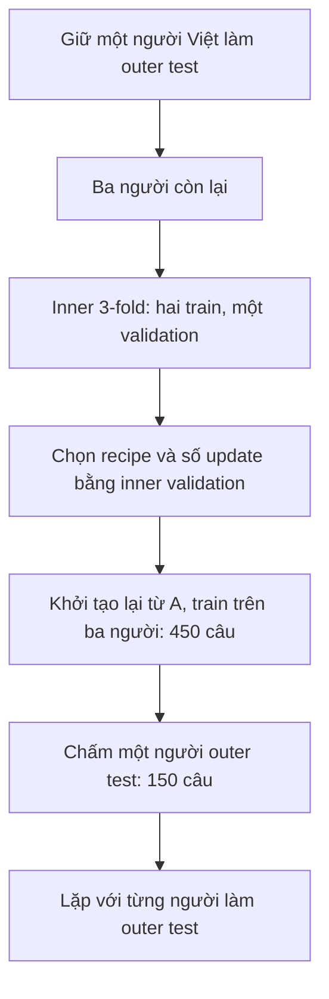

# Cơ sở chia dữ liệu và phương án phù hợp cho bài test

**Với mục tiêu demo MDD cho người Việt mới, phương án đề xuất là vẫn chia 2 người Việt train / 1 validation / 1 test, nhưng cân đối một nam và một nữ trong target train của cả bốn fold.** Phương án v2 giữ nguyên số mẫu và số lượt train, khắc phục hai fold v1 chỉ có một giới trong phần Việt train. Đây là lựa chọn thiết kế dựa trên metadata, chưa có thực nghiệm chứng minh F1 tăng. Chuyển từ Colab sang CPU local không thay đổi nguyên tắc đánh giá này.

Code và notebook hiện vẫn dùng `l2arctic-v1`. Bản [v2 đề xuất](../data/proposals/l2arctic-v2-balanced/proposal.json) được lưu riêng với trạng thái `proposed_not_active`; manifest/split v1 không bị ghi đè. Tài liệu phân biệt cấu hình đang chạy với phương án nên dùng trước khi chốt thí nghiệm.

Cách chia quyết định câu hỏi mà phép đánh giá trả lời. Nó giúp kiểm soát việc chọn model và đo khả năng tổng quát hóa; bản thân việc chia không tạo thêm thông tin học hay bảo đảm tăng độ chính xác.

## Dữ liệu thực sự có nhãn

| Nhóm | Người nói | Câu annotated dùng được |
| --- | ---: | ---: |
| Ngoài Việt Nam, năm nhóm L1 | 20 | 2.999 |
| Việt Nam: HQTV, PNV, THV, TLV | 4 | 600 |
| Tổng | 24 | 3.599 |

Người Việt có 4.528 WAV trong toàn bộ phần đọc, nhưng chỉ **600 câu có nhãn lỗi thủ công**. Không coi toàn bộ WAV hoặc forced alignment là ground truth MDD. [Tài liệu corpus chính thức](https://psi.engr.tamu.edu/l2-arctic-corpus-docs/)

Số liệu kiểm kê local, hash và kiểm tra overlap được lưu ở [báo cáo audit](../data/generated/setup/split_audit.md), [JSON](../data/generated/setup/split_audit.json). Lệnh chạy lại:

```bash
.venv/bin/python scripts/audit_data_split.py
```

Audit kiểm tra cấu trúc dữ liệu, không chạy model và không thay split để tìm tập test dễ hơn.

## Tại sao chia theo người nói

Mỗi người có đặc điểm giọng, tốc độ, mức phát âm và điều kiện thu riêng. Nếu xáo trộn 600 câu rồi chia 80/20, cùng một người có thể xuất hiện ở cả hai phía. Phép đo khi đó chủ yếu trả lời khả năng xử lý câu khác của những người đã gặp, trong khi app cần phục vụ người mới.

Giữ tất cả mẫu của một người trong cùng vai trò của từng lượt train là cách áp dụng grouped validation. Tách người ở test là điều kiện quan trọng khi kết luận về người học mới. [Hướng dẫn grouped cross-validation](https://scikit-learn.org/stable/modules/cross_validation.html#cross-validation-iterators-for-grouped-data)

## Tại sao nguồn chia 15 người train và 5 người validation

Mỗi nhóm L1 ngoài Việt Nam có bốn người. Protocol giữ một người mỗi nhóm làm source validation; còn ba người mỗi nhóm để train. Vì vậy:

- **15 người, 2.249 câu** cập nhật trọng số model A.
- **5 người, 750 câu** chọn checkpoint và cấu hình nguồn.
- Cả năm L1 đều có mặt trong train và validation, nhưng không trùng người.

Đây là thiết kế 3/1 theo người trong từng L1; không phải định luật rằng 75/25 luôn tối ưu. Cách chọn người đã được khóa trước khi có kết quả model. Không chuyển người hoặc câu giữa các tập chỉ vì một split cho F1 cao hơn. [Split cụ thể](../data/protocol/l2arctic-v1/splits.json)

A được dùng chung cho bốn fold Việt vì A và việc chọn A chỉ dùng dữ liệu nguồn. A không được học hoặc chọn tham số bằng bất kỳ người Việt nào nếu vẫn được mô tả là baseline trước thích ứng.

## Tại sao Việt Nam chia 300 train 150 validation 150 test

Mỗi người Việt có 150 câu annotated. Có bốn người, nên mỗi lượt giữ hai người train, một người validation và một người test:

| Fold | Train: 300 câu | Validation: 150 câu | Test: 150 câu |
| --- | --- | --- | --- |
| 1 | THV, TLV | PNV | HQTV |
| 2 | HQTV, TLV | THV | PNV |
| 3 | HQTV, PNV | TLV | THV |
| 4 | PNV, THV | HQTV | TLV |

**50/25/25 là hệ quả của bốn người nói**, không phải một tỷ lệ có ưu thế đã được chứng minh. Train cung cấp gradient; validation chọn checkpoint; test đo kết quả trên người chưa học và chưa dùng để chọn model của lượt đó.

Bốn lượt giúp mỗi người được làm test đúng một lần. Tuy nhiên, mỗi outer fold hiện chỉ có một lựa chọn validation cố định, chưa phải nested cross-validation đầy đủ. Với một seed cần một A và tám lượt B/C, tức **9 lượt train**; ba seed cần 27 lượt.

Một người có thể làm train ở fold này và test ở fold khác. Điều đó hợp lệ khi các lượt độc lập: B/C của mỗi fold khởi tạo lại từ A; không train tiếp model thích ứng của fold trước.

## Điều chỉnh phù hợp nhất với dữ liệu hiện có

README corpus ghi HQTV và TLV là M, PNV và THV là F. V1 fold 2 train HQTV/TLV chỉ có nam; fold 4 train PNV/THV chỉ có nữ. A và source replay đã có nhiều người nói nên không phải toàn bộ model chỉ gặp một giới, nhưng thành phần target train giữa các fold chưa đồng nhất.

V2 đề xuất giữ source train/dev như cũ và thay vai trò Việt như sau:

| Fold | Train: 300 câu | Validation: 150 câu | Test: 150 câu | Metadata train |
| --- | --- | --- | --- | --- |
| 1 | THV, TLV | PNV | HQTV | F + M |
| 2 | HQTV, THV | TLV | PNV | M + F |
| 3 | PNV, TLV | HQTV | THV | F + M |
| 4 | HQTV, PNV | THV | TLV | M + F |

Cả bốn cặp nam–nữ có thể tạo từ dữ liệu đều được dùng một lần. Mỗi người xuất hiện hai lần ở train, một lần ở validation và một lần ở test. Bốn fold vẫn tách người và audio, vẫn có 300/150/150 mẫu, vẫn cần 9 lượt train/seed. Không dùng tỷ lệ lỗi hay điểm model để chọn cách ghép này.

Mục tiêu là làm điều kiện thích ứng Việt nhất quán hơn giữa các fold, không chứng minh giới tính gây ra chênh lệch phát âm. Với hai nam/hai nữ, khi train luôn nam–nữ thì validation và test còn lại buộc thuộc hai giới khác nhau. Chỉ bốn người chưa tách được ảnh hưởng của danh tính, trình độ, giọng vùng hay giới tính.

Để kiểm tra hoặc tạo lại đề xuất:

```bash
python3 scripts/propose_balanced_split.py --verify-only
```

[splits.json đề xuất](../data/proposals/l2arctic-v2-balanced/splits.json) chứa ID cụ thể; [proposal.json](../data/proposals/l2arctic-v2-balanced/proposal.json) ghi tiêu chí, nguồn metadata và checksum cha. Script tạo đề xuất không đọc nhãn lỗi hoặc kết quả model. V1 vẫn là một thiết kế hợp lệ; không chạy cả hai rồi chọn phiên bản có test cao hơn để gọi là kết quả độc lập.

V2 cần được chuyển thành protocol thực thi riêng, cập nhật tham chiếu config/notebook và đóng gói lại trước khi train theo nó. Các thao tác kích hoạt đó chưa được thực hiện bởi việc audit và đề xuất này.

## Kết quả hiện tại đo người mới trên các câu trong miền đã học

Audit cho thấy **cả 150 mã câu test của mỗi fold đều đã có trong source train và Vietnamese train của fold đó**. Audio và người nói vẫn tách biệt. Corpus được thiết kế có câu đọc chung giữa các người; trùng mã câu không có nghĩa trùng bản ghi.

Theo toàn bộ 3.599 mẫu có 300 mã câu và 333 nội dung transcript sau chuẩn hóa nhẹ. Một số cùng mã câu có khác biệt cách ghi transcript, nên kiểm tra nội dung bằng chuỗi text đơn thuần có thể nhầm chúng thành câu mới. Khi kiểm tra prompt mới phải giữ cả mã câu và biến thể text. [Audit trực tiếp dữ liệu](../data/generated/setup/split_audit.md)

Vì vậy, phạm vi kết luận phù hợp là **người Việt mới đọc các câu thuộc miền L2-ARCTIC, với nội dung đã xuất hiện ở người train**. Đây là câu hỏi phù hợp cho demo đọc câu mẫu. Kết quả không chứng minh khả năng trên câu hoàn toàn mới, hội thoại tự do hoặc thiết bị thu ngoài corpus.

Nếu cần đánh giá câu mới, tạo một protocol riêng: khóa một tập mã câu trước khi chạy model, loại tất cả bản ghi của các mã đó khỏi source train, source validation và target train/validation; test chỉ dùng chúng ở người test. Chỉ loại khỏi Vietnamese train vẫn chưa đủ vì A có thể đã học chúng từ source. Phép kiểm tra này giảm lượng dữ liệu và cần báo riêng với protocol hiện tại.

## Cách làm của các paper

| Nghiên cứu | Thiết kế được mô tả trong paper | Điều áp dụng được |
| --- | --- | --- |
| Peng et al. 2021, §3.2 | Sáu người làm test; 18 người còn lại tạo train/dev. Paper không mô tả rõ dev tách theo người | Có held-out test speakers; không suy ra mọi vai trò đều speaker-disjoint |
| Xu et al. 2021, §3.1 | 18 người train; TXHC và YKWK làm dev; NJS, TLV, TNI, ZHAA làm test | Ví dụ tách cả train/dev/test theo người |
| Peng et al. 2022, §3.1 | Sáu người test; trên 18 người còn lại lấy ngẫu nhiên 20% câu mỗi người làm dev | Test tách người, train/dev có thể chung người |

Nguồn gốc: [Peng 2021](https://www.isca-archive.org/interspeech_2021/peng21e_interspeech.pdf), [Xu 2021](https://www.isca-archive.org/interspeech_2021/xu21k_interspeech.pdf), [Peng 2022](https://arxiv.org/pdf/2206.07289). Bảng Xu ghi số câu dev không khớp phép tính hai người × 150 của bản local hiện tại; ở đây chỉ đối chiếu thiết kế chia người.

Protocol project nghiên cứu **thích ứng riêng giọng Việt**, nên khác benchmark MDD nhiều accent của các paper. Không lấy F1 paper làm điểm kỳ vọng trực tiếp khi split, inventory và scorer khác nhau. Paper corpus Zhao 2018 mô tả bản đầu; số liệu 24 người và nhóm Việt lấy từ bản phát hành hiện tại. [Lịch sử corpus](https://psi.engr.tamu.edu/l2-arctic-corpus/)

## Quy trình nên dùng cho bài test này

1. **Chốt phiên bản split trước test.** Với thí nghiệm chưa bắt đầu, ưu tiên v2 cân đối metadata; nếu tiếp tục v1, giữ nguyên và báo đúng điều kiện của v1. Khóa preprocessing, scorer, recipe và seed.
2. Train A bằng source train, chọn A bằng source validation. Với mỗi fold, train B và C từ đúng cùng A.
3. Chọn checkpoint bằng validation riêng của fold; hoàn tất mọi lựa chọn rồi mới chấm test của cả bốn fold.
4. Lưu dự đoán của mọi câu; báo F1, PER, FRR, DER và delta B−A/B−C theo từng người, kèm kết quả gộp.
5. Sau vòng đánh giá đã khóa, mới tạo checkpoint phục vụ demo bằng nhiều dữ liệu hơn nếu cần.

Không lấy kết quả validation của cả bốn fold để chọn một cấu hình chung rồi báo bốn test như hoàn toàn độc lập: mỗi người validation cũng là test của fold khác. Muốn tune trong từng outer fold, chỉ dùng phần train/dev của outer fold đó. Việc tối ưu lựa chọn model trên quá nhiều kết quả có thể gây selection bias. [Cawley và Talbot 2010](https://www.jmlr.org/papers/v11/cawley10a.html)

Với tài nguyên hiện tại, nên dùng recipe khởi đầu đã có trên phiên bản split được chốt, hoàn tất đủ bốn người test thay vì tìm nhiều cấu hình trên một người test. Nếu đủ thời gian tính toán, thêm seed 123 và 2026 để đánh giá biến động tối ưu. Nhiều seed không thay thế việc bổ sung người nói độc lập.

### Làm rõ đối chứng B và C

Code hiện train B/C với cùng `max_steps=400`, nhưng chọn best checkpoint riêng theo validation; hai checkpoint tốt nhất có thể ở các bước khác nhau. Đó là so sánh hai quy trình cùng **ngân sách tối đa**, chưa phải so sánh hai bộ weights sau đúng cùng số update.

Nên khai báo trước hai bảng, không chọn bảng có test đẹp hơn để báo:

| Bảng | Checkpoint B/C | Câu hỏi |
| --- | --- | --- |
| Best-validation | `best_checkpoint/` | Model được chọn theo validation hoạt động thế nào? |
| Fixed-update | `checkpoint/` khi hoàn tất 400 bước | Với cùng đúng 400 update, thêm dữ liệu Việt thay đổi kết quả ra sao? |

A trong cả hai bảng vẫn là **đúng best checkpoint nguồn đã khởi tạo B/C**. C chỉ học gradient trên source nhưng cũng dùng validation Việt để chọn best; không gọi C là hoàn toàn không dùng nhãn Việt. Runtime đã lưu bước checkpoint, nguồn khởi tạo và ngân sách để kiểm tra. [Runtime](../src/mdd/runtime.py)

Có thể chấm bảng fixed-update bằng CLI hiện có, vào thư mục output mới:

```bash
python scripts/evaluate_mdd.py --checkpoint /content/drive/MyDrive/MDD/runs/B-fold1-seed42/checkpoint --split test --fold 1 --output-dir /content/drive/MyDrive/MDD/runs/B-fold1-seed42/evaluation/fold1-test-fixed400 --device cuda
python scripts/evaluate_mdd.py --checkpoint /content/drive/MyDrive/MDD/runs/C-fold1-seed42/checkpoint --split test --fold 1 --output-dir /content/drive/MyDrive/MDD/runs/C-fold1-seed42/evaluation/fold1-test-fixed400 --device cuda
python scripts/compare_mdd_runs.py --a /content/drive/MyDrive/MDD/runs/A-seed42/evaluation/fold1-test --b /content/drive/MyDrive/MDD/runs/B-fold1-seed42/evaluation/fold1-test-fixed400 --c /content/drive/MyDrive/MDD/runs/C-fold1-seed42/evaluation/fold1-test-fixed400 --output /content/drive/MyDrive/MDD/runs/comparisons/fold1-seed42-fixed400
```

Các lệnh trên minh họa đường dẫn Colab. Với local, dùng đường dẫn `runs/local-...` tương ứng trong [TRAINING.md](../TRAINING.md) và `--device cpu`. Chúng chưa được chạy để tạo kết quả A/B/C trong workspace hiện tại. Notebook chấm bảng best-validation mặc định; fixed-update là phân tích bổ sung dùng CLI.

## Khi nào nên dùng nested LOSO

Nếu mục tiêu chuyển sang nghiên cứu nhiều learning rate, tỷ lệ replay hoặc phương án freeze, nested leave-one-speaker-out là phương án chặt hơn về model selection. Sơ đồ áp dụng cho bốn người:



Inner validation giúp chọn recipe; outer test đánh giá cả quy trình lựa chọn. [Ví dụ nested CV chính thức](https://scikit-learn.org/stable/auto_examples/model_selection/plot_nested_cross_validation_iris.html)

Refit 450 câu phải dùng stopping budget đã khóa trước, chẳng hạn median best step từ các inner fold theo một quy tắc khai báo sẵn. Để đối chứng B/C, giữ cùng budget refit; không dùng outer test chọn checkpoint. Quy tắc median là một lựa chọn thiết kế của thí nghiệm, không phải optimum được paper bảo đảm.

Với `K` cấu hình mỗi nhánh B/C và `S` seed, nếu A được chọn chỉ bằng source:

| Phương án | Số lượt fit |
| --- | ---: |
| V1 hoặc v2 đề xuất, một cấu hình | `9S` |
| Chia 2/1/1, thử K cấu hình mỗi nhánh trong từng outer fold | `S × (1 + 8K)` |
| Nested, ba inner folds và refit mỗi nhánh | `S × (24K + 9)` |

Ngay `K=1`, nested cần 33 fit/seed thay vì 9. Nó tận dụng 450 câu khi refit nhưng không bảo đảm F1 cao hơn. Runtime hiện chạy v1; nested/refit 450 cần protocol và orchestration mới, không sửa đè manifest đang dùng.

## Tận dụng thêm dữ liệu để có model triển khai

Sau khi hoàn tất đánh giá, có thể dùng toàn bộ **600 câu Việt** để train checkpoint demo theo recipe đã chốt. Với v1, đây là quyết định triển khai, không phải bằng chứng checkpoint mới tốt nhất; cần kiểm tra người học mới để đánh giá nó. Không gắn điểm test của các checkpoint cross-validation cho chính checkpoint đã học cả bốn người.

Để tăng khả năng tổng quát hóa, ưu tiên thêm **người Việt độc lập**, trình độ và thiết bị thu đa dạng, với nhãn được kiểm tra. Thêm nhiều câu từ cùng bốn người cung cấp thêm tín hiệu nhưng không tạo độ đa dạng tương đương thêm người. Phần WAV chưa có nhãn chỉ nên dùng trong thí nghiệm pseudo-label hoặc tự giám sát riêng; khi đánh giá người mới, không đưa audio của người test vào bước thích ứng không nhãn.

Pipeline hiện chưa có chế độ refit toàn bộ 600 câu, nên cần tạo config/protocol riêng khi triển khai bước đó. Không lấy 600 câu chia ngẫu nhiên lại để tạo một test có vẻ lớn hơn.

## Phạm vi của kết luận thống kê

Có 600 utterance Việt nhưng chỉ **bốn người nói độc lập**. Báo từng người, macro theo người, bộ đếm gộp out-of-fold và delta ghép cặp B−C. Pooled F1 và trung bình F1 từng người là hai phép tổng hợp khác nhau, cần đặt tên rõ.

Độ lệch chuẩn qua bốn fold chỉ mô tả biến thiên, không tự là khoảng tin cậy 95%. Không làm t-test coi 600 câu là 600 người độc lập; các lỗi cross-validation có phụ thuộc. [Bengio và Grandvalet 2004](https://jmlr.org/papers/v5/grandvalet04a.html)

Muốn kết luận model phục vụ tốt người Việt nói chung, cần tập ngoài gồm người mới và nội dung phù hợp ứng dụng. Với dữ liệu hiện có, kết luận nên giới hạn ở bốn người, miền câu đọc và protocol đã mô tả.
