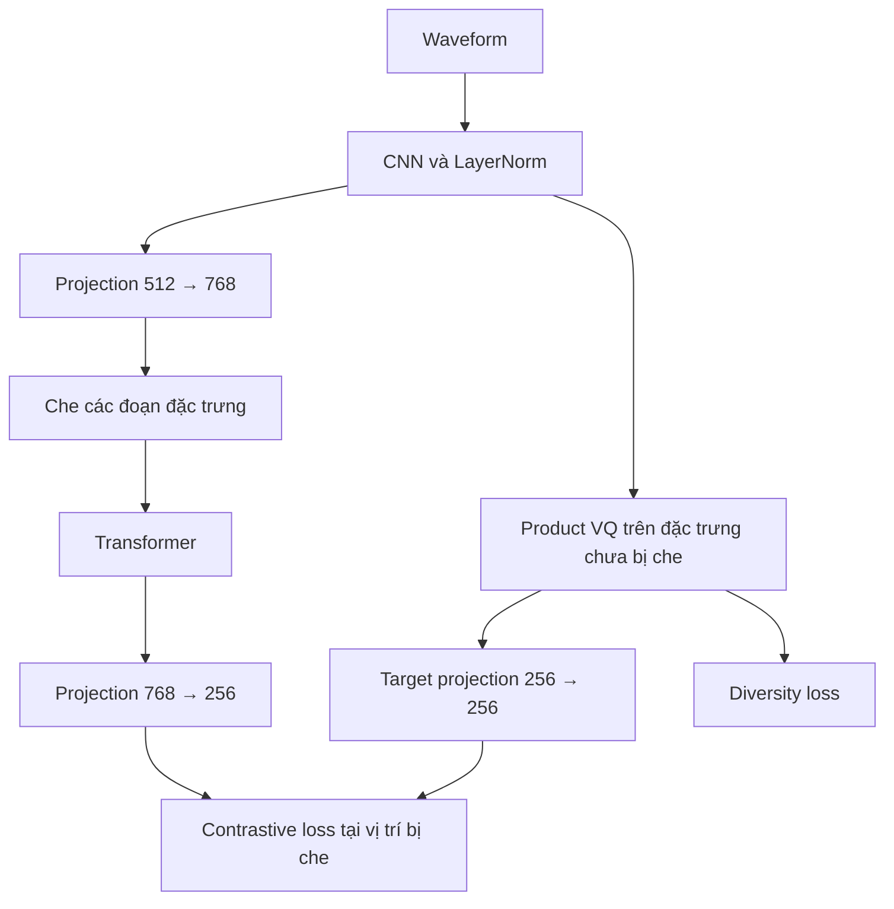
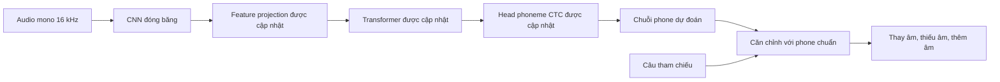

# Lý thuyết STT TTS và fine tuning wav2vec 2.0

Pipeline hiện tại học nhận dạng **chuỗi phoneme người học thực sự phát âm**, rồi đối chiếu với câu tham chiếu để phát hiện lỗi. CNN và Transformer tạo biểu diễn âm thanh; head CTC chuyển biểu diễn đó thành phone. Nhánh Vector Quantization giúp học biểu diễn trong pre-training. TTS tạo giọng đọc mẫu và phản hồi qua ai33.

Các đoạn giả mã dưới đây mô tả luồng xử lý và gradient, không phải script thay thế code train. Những hàm như `Linear`, `LayerNorm`, `length_regulate` đại diện cho các module có tham số được khởi tạo trước vòng lặp.

## STT TTS và MDD khác nhau ở đầu ra

| Tác vụ | Input | Output | Cách dùng trong ứng dụng |
| --- | --- | --- | --- |
| STT hoặc ASR | Audio lời nói | Transcript chữ hoặc subword được ghép thành chữ | Hiển thị người dùng đã nói gì |
| Nhận dạng phoneme | Audio lời nói | Chuỗi âm như `T IH NG K` | Ước lượng các âm người học đã phát ra |
| MDD | Audio và câu tham chiếu, hoặc phone chuẩn tương ứng | Các lỗi thay, thiếu, thêm âm và vị trí | Đánh dấu phần cần luyện |
| TTS | Text và điều kiện giọng theo model | Waveform và sample rate, hoặc biểu diễn để giải mã thành waveform | Đọc câu mẫu và lời hướng dẫn |

Ví dụ người học đọc “think” thành `/tɪŋk/`: transcript chữ vẫn có thể là **think**, trong khi chuỗi phone cho thấy `T` thay cho `TH`. Vì vậy, transcript đúng không đủ chứng minh phát âm đúng. Trong project, `TH` là một token ARPABET biểu diễn `/θ/`, không phải hai token `T` và `H`.

MVP dùng câu tham chiếu có sẵn, nên `asr_text=null`. Muốn hội thoại tự do có transcript chữ cần thêm nhánh ASR hoặc mô hình đa nhiệm được huấn luyện riêng. CNN và Transformer là thành phần kiến trúc có thể dùng cho nhiều tác vụ; head, dữ liệu và loss quyết định model học tác vụ nào. [Contract hiện tại](../contracts/README.md)

## Từ audio đến tensor

Waveform là dãy biên độ theo thời gian. Audio mono 1 giây ở 16 kHz có 16.000 số thực, không phải 16.000 phoneme. Mel-spectrogram mô tả năng lượng theo thời gian và các dải tần mel. Embedding là vector đặc trưng do network học. Ba biểu diễn này có ý nghĩa và số chiều khác nhau.

Các ký hiệu dùng trong giả mã:

| Ký hiệu | Ý nghĩa |
| --- | --- |
| `B` | Số audio trong batch |
| `N` | Số mẫu waveform sau resample |
| `T` | Số frame sau CNN |
| `z` | Đặc trưng CNN, mỗi frame 512 chiều |
| `H`, `C` | Biểu diễn trước và sau Transformer, 768 chiều |
| `q` | Vector rời rạc được chọn từ codebook trong pre-training |
| `y` | Chuỗi token đích của tác vụ có giám sát |

Không phải mọi STT có cùng đầu vào: wav2vec 2.0 nhận waveform, còn Whisper nhận log-mel. Chuỗi xử lý phải phù hợp checkpoint. [Whisper, §2](https://arxiv.org/abs/2212.04356), [cấu hình BASE local](../models/pretrained/wav2vec2-base/config.json)

Trong project, `load_audio()` đọc audio, chuyển mono và resample thực sự về 16 kHz. Sau đó `Wav2Vec2FeatureExtractor` chuẩn hóa biên độ và đóng gói tensor. Class tiền xử lý này **khác** CNN feature encoder nằm bên trong network; chỉ truyền `sampling_rate=16000` không biến audio 44,1 kHz thành audio 16 kHz. [Code xử lý audio](../src/mdd/runtime.py), [feature extractor Transformers 4.57.6](https://raw.githubusercontent.com/huggingface/transformers/v4.57.6/src/transformers/models/wav2vec2/feature_extraction_wav2vec2.py)

## CNN feature encoder

CNN 1D trượt các bộ lọc trên waveform để học đặc trưng âm học cục bộ, đồng thời giảm số vị trí thời gian. Một bộ lọc có thể phản ứng với các dạng tín hiệu có ích cho nhận dạng, nhưng từng channel không được gán trước là một phoneme cụ thể. Trước normalization và activation, convolution tính tổng có trọng số:

```text
out[b, c, t] = Σ_i Σ_j W[c, i, j] × input[b, i, t × stride + j]
```

`i` chạy qua channel đầu vào, `j` chạy qua kernel; cùng bộ trọng số `W` được dùng ở các vị trí thời gian khác nhau.

Checkpoint BASE đang dùng có cấu hình sau, đọc trực tiếp từ [config.json local](../models/pretrained/wav2vec2-base/config.json):

| Lớp CNN | Kernel | Stride | Output channels | Bước nhảy tích lũy theo waveform |
| --- | ---: | ---: | ---: | ---: |
| 1 | 10 | 5 | 512 | 5 |
| 2 | 3 | 2 | 512 | 10 |
| 3 | 3 | 2 | 512 | 20 |
| 4 | 3 | 2 | 512 | 40 |
| 5 | 3 | 2 | 512 | 80 |
| 6 | 2 | 2 | 512 | 160 |
| 7 | 2 | 2 | 512 | 320 |

Với convolution không padding, dilation bằng 1, độ dài qua từng lớp là `floor((L_in - kernel) / stride) + 1`. Áp dụng bảy lớp trên cho ra công thức dưới đây; đây là phép tính từ cấu hình, không phải kết quả benchmark. [Công thức Conv1d](https://docs.pytorch.org/docs/2.7/generated/torch.nn.Conv1d.html)

```text
T = floor((N - 400) / 320) + 1, với N >= 400

Audio 1 giây: N = 16.000 → T = 49 frames
Audio 5 giây: N = 80.000 → T = 249 frames

Hop của CNN:             320 samples = 20 ms
Receptive field của CNN: 400 samples = 25 ms
```

25 ms là **receptive field cấu trúc của chuỗi convolution**. Chuẩn hóa waveform và GroupNorm còn dùng thống kê cả đoạn, nên toàn bộ giá trị đầu ra không chỉ phụ thuộc cửa sổ đó. Sau Transformer, frame còn nhận ngữ cảnh qua attention. Với audio dài, tốc độ frame tiến gần 50 frame/giây; số frame không phải số phoneme.

Giả mã CNN và feature projection của cấu hình local:

```python
def encode_waveform(waveform):                    # [B, N]
    h = waveform[:, None, :]                     # [B, 1, N]
    kernels = [10, 3, 3, 3, 3, 2, 2]
    strides = [5, 2, 2, 2, 2, 2, 2]

    for i in range(7):
        h = conv[i](h)                            # Conv1D, 512 channels
        # conv[i]: kernel=kernels[i], stride=strides[i],
        #          padding=0, bias=False
        if i == 0:
            h = first_layer_group_norm(h)         # groups=512
        h = GELU(h)

    z = transpose(h, axes=[0, 2, 1])              # [B, T, 512]
    z_norm = feature_layer_norm(z)
    H = feature_dropout(feature_linear(z_norm))  # Linear 512 -> 768
    return z_norm, H
```

`conv[i]` là bảy module khác nhau. GroupNorm nằm ở CNN đầu trong cấu hình `feat_extract_norm="group"`; LayerNorm sau CNN thuộc **feature projection**. Khi code đóng băng CNN, feature projection vẫn có thể được cập nhật. [Hàm `load_model()` của project](../src/mdd/runtime.py)

## Transformer context encoder

Self-attention cho mỗi vị trí so sánh với các vị trí khác trong cùng audio. Với một head, `Q` là biểu diễn truy vấn, `K` dùng để tính mức liên quan và `V` là thông tin được tổng hợp:

```text
Attention(Q, K, V) = softmax(QKᵀ / sqrt(d_k) + padding_bias) V
```

Multi-head attention thực hiện nhiều phép tổng hợp song song, rồi ghép và chiếu kết quả. Feed-forward network biến đổi từng vị trí; residual connection và LayerNorm hỗ trợ tối ưu network sâu. Padding bias bằng 0 tại vị trí hợp lệ và âm vô cùng tại vị trí đệm, khác việc che nội dung để tạo bài toán tự giám sát. [Attention Is All You Need, §3](https://arxiv.org/abs/1706.03762)

Cấu hình checkpoint local có **12 blocks, hidden size 768, 12 attention heads**, mỗi head 64 chiều và FFN 3072 chiều. Positional convolution có kernel 128, groups 16. `do_stable_layer_norm=false` chọn kiểu post-LayerNorm. Các con số này mô tả checkpoint đang dùng. [Config local](../models/pretrained/wav2vec2-base/config.json)

Giả mã một encoder với các kích thước trên:

```python
def context_encoder(H, padding_bias=0):           # [B, T, 768]
    position = GELU(position_conv_same_length(H)) # giữ nguyên T
    H = dropout(input_layer_norm(H + position))

    for block in blocks:                          # 12 bộ tham số riêng
        Q = split_heads(block.q_proj(H), heads=12)
        K = split_heads(block.k_proj(H), heads=12)
        V = split_heads(block.v_proj(H), heads=12)
        # Q, K, V: [B, 12, T, 64]

        scores = Q @ transpose_last_two(K) / sqrt(64)
        weights = softmax(scores + padding_bias, axis=-1)
        attended = merge_heads(dropout(weights) @ V)
        H = block.norm1(H + dropout(block.out_proj(attended)))

        F = block.linear2(GELU(block.linear1(H))) # 768 -> 3072 -> 768
        H = block.norm2(H + dropout(F))

    return H                                     # C: [B, T, 768]
```

Attention của encoder này nhìn hai chiều trong đoạn audio được đưa vào. Muốn streaming phải thiết kế cách chia chunk và ngữ cảnh; gọi model lên cả clip không tự tạo khả năng xử lý luồng liên tục. Positional convolution cũng không phải bảng vị trí sinusoidal của mọi Transformer.

## Quantization Module và Vector Quantization

Vector Quantization biểu diễn một vector liên tục bằng lựa chọn từ tập vector học được gọi là **codebook**. Với wav2vec 2.0, biểu diễn rời rạc này tạo mục tiêu cho pre-training; mã được chọn không được gán sẵn ý nghĩa `TH`, `T` hay một từ tiếng Anh.

Ba khái niệm cần phân biệt:

| Khái niệm | Đối tượng được lượng tử hóa | Mục đích |
| --- | --- | --- |
| Product VQ trong wav2vec 2.0 | Đặc trưng âm thanh trong nhánh target | Học biểu diễn bằng mục tiêu tự giám sát |
| Neural audio codec trong TTS kiểu VALL-E | Audio thành các mã codec | Dự đoán mã rồi giải mã thành âm thanh |
| Quantization INT8/INT4 khi triển khai | Trọng số và có thể cả activation | Giảm bộ nhớ hoặc chi phí tính toán |

VALL-E dự đoán mã của một audio codec; codebook đó có vai trò khác codebook target của wav2vec 2.0. [VALL-E, §3](https://arxiv.org/abs/2301.02111)

### Product VQ trong checkpoint BASE

Theo [config local](../models/pretrained/wav2vec2-base/config.json), quantizer có `G=2` nhóm, mỗi nhóm `V=320` codeword. Mỗi codeword nhóm có 128 chiều; chọn một từ mỗi nhóm rồi ghép thành vector 256 chiều. Tổng cộng lưu 640 vector, tạo tối đa `320² = 102.400` tổ hợp, không lưu riêng 102.400 vector.

Quantizer học logits lựa chọn qua một linear layer từ đặc trưng 512 chiều. Nó dùng **Gumbel-Softmax**, không dùng phép tìm codeword gần nhất theo khoảng cách Euclid như một số VQ khác. Khi train, forward chọn cứng nhưng backward dùng gradient xấp xỉ qua phân phối mềm; khi eval nhánh pre-training, chọn argmax. [Gumbel-Softmax](https://arxiv.org/abs/1611.01144), [implementation fairseq](https://raw.githubusercontent.com/facebookresearch/fairseq/main/fairseq/modules/gumbel_vector_quantizer.py)

```python
def product_quantize(z_norm, training, temperature):  # [B, T, 512]
    logits = code_selector(z_norm)                    # Linear 512 -> 640
    logits = reshape(logits, [B, T, 2, 320])

    if training:
        u = uniform_open_interval_0_1(shape(logits))
        gumbel_noise = -log(-log(u))
        soft = softmax((logits + gumbel_noise) / temperature, axis=-1)
        hard = one_hot(argmax(soft, axis=-1), classes=320)
        weights = stop_gradient(hard - soft) + soft
    else:
        weights = one_hot(argmax(logits, axis=-1), classes=320)

    # codebook: [2, 320, 128]; một lựa chọn cho mỗi group
    selected = einsum("btgv,gvd->btgd", weights, codebook)
    quantized = reshape(selected, [B, T, 256])
    q = target_projection(quantized)                  # Linear 256 -> 256
    return q, logits
```

`stop_gradient(hard - soft) + soft` có giá trị forward bằng `hard`, nhưng gradient đi qua `soft`. Đây là straight-through estimator; nó không biến phép argmax thành hàm khả vi chính xác. Nhiệt độ Gumbel điều chỉnh độ mềm của lựa chọn, khác nhiệt độ dùng cho contrastive logits. [PyTorch Gumbel-Softmax](https://docs.pytorch.org/docs/2.7/generated/torch.nn.functional.gumbel_softmax.html)

## Self Supervised Pre training

Self-supervised learning tạo tín hiệu giám sát từ chính dữ liệu. Với wav2vec 2.0, audio không cần transcript: model phải xác định biểu diễn rời rạc đúng tại vị trí bị che, dựa trên ngữ cảnh âm thanh. Cả encoder và quantizer được học, target không phải nhãn phoneme do con người cung cấp. [wav2vec 2.0, §2](https://arxiv.org/abs/2006.11477)



Nhánh ngữ cảnh phải chọn target đúng từ target cùng frame và 100 target nhiễu lấy ở các vị trí bị mask khác **trong cùng utterance**. Việc che xảy ra sau CNN trên nhánh đưa vào Transformer; nhánh tạo `q` đọc đặc trưng chưa bị che. Gradient contrastive cũng đi về nhánh target, không chủ động chặn bằng `detach(q)`.

Ví dụ mục tiêu tối giản, chuẩn hóa theo số frame được chấm:

```python
for waveform in unlabeled_audio:
    z_norm, H = encode_waveform(preprocess(waveform))
    mask = sample_valid_time_spans(H)
    masked_H = replace_with_learned_mask_embedding(H, mask)
    C = context_encoder(masked_H)

    q, code_logits = product_quantize(z_norm, training=True,
                                      temperature=gumbel_temperature)
    context = context_projection(C)                 # 768 -> 256
    positive = q[mask]
    negatives = sample_other_masked_targets(q, mask, count=100,
                                            within_same_utterance=True)
    candidates = concatenate_positive_and_negatives(positive, negatives)

    scores = cosine_similarity(context[mask], candidates) / 0.1
    scores = suppress_negatives_identical_to_positive(scores, candidates)
    L_contrastive = cross_entropy(scores, target_index=0, reduction="mean")

    p = average_over_masked_positions(softmax(code_logits, axis=-1), mask)
    perplexity = sum(exp(entropy(p[g])) for g in range(2))
    L_diversity = (2 * 320 - perplexity) / (2 * 320)

    loss = L_contrastive + 0.1 * L_diversity
    optimizer.zero_grad()
    loss.backward()                                 # cả hai nhánh được học
    optimizer.step()
```

Contrastive loss thưởng cho phân biệt target đúng với target nhiễu. Diversity loss khuyến khích dùng nhiều codeword để tránh chỉ chọn một vài mã. Trong implementation HF đang cài, contrastive loss dùng tổng và diversity được nhân số frame bị che; giả mã trên chia về cùng đơn vị trung bình. [Implementation Transformers 4.57.6](https://raw.githubusercontent.com/huggingface/transformers/v4.57.6/src/transformers/models/wav2vec2/modeling_wav2vec2.py)

Recipe fairseq gốc còn có regularization năng lượng đặc trưng CNN và hệ số giảm gradient về feature encoder; giả mã tối giản này không tái lập toàn bộ recipe. [Recipe LS960](https://raw.githubusercontent.com/facebookresearch/fairseq/main/examples/wav2vec/config/pretraining/wav2vec2_base_librispeech.yaml), [model fairseq](https://raw.githubusercontent.com/facebookresearch/fairseq/main/fairseq/models/wav2vec/wav2vec2.py)

Paper mô tả chọn 6,5% vị trí làm điểm bắt đầu span dài 10 frame; do các span chồng lấp, khoảng 49% frame bị che. **6,5% điểm bắt đầu không đồng nghĩa 6,5% frame.** Cấu hình local lưu `mask_time_prob=0.05`, có ngữ nghĩa lấy mẫu span theo implementation; không suy ngược lịch pre-training lịch sử chỉ từ giá trị đó. [wav2vec 2.0, §4.2](https://arxiv.org/html/2006.11477v3)

Project dùng weights đã pre-train được tải về. Không chạy lại vòng self-supervised trên L2-ARCTIC trong pipeline hiện tại.

## CTC chuyển biểu diễn thành chuỗi phone

Head hiện tại là `Linear(768, 83)`, tạo logits `[B, T, 83]`. Các lớp output gồm 40 phone, 40 biến thể `*`, `err`, `[UNK]` và `[PAD]`. `[PAD]=0` làm CTC blank; padding của target dùng `-100` và bị loại khi tính loss. [Vocabulary](../data/processed/l2arctic-v1/vocab.json), [collator và `load_model()`](../src/mdd/runtime.py)

CTC cho phép học chuỗi khi chưa có đáp án cho từng frame. Nó cộng xác suất mọi đường căn chỉnh hợp lệ:

```text
P(y | audio) = Σ trên π có Collapse(π)=y [ Π_t P(π_t | audio) ]
L_CTC        = -log P(y | audio)
```

Blank biểu thị không xuất token ở frame đó, không phải khoảng trắng giữa từ. Greedy decoding chọn token tốt nhất từng frame, gộp token lặp liền nhau, rồi bỏ blank; không bảo đảm tìm chuỗi có tổng xác suất lớn nhất. [CTC, Graves et al. 2006, §3–4](https://www.cs.toronto.edu/~graves/icml_2006.pdf)

```python
def decode_phone_ctc(logits, id_to_phone, blank_id=0):  # một mẫu [T, 83]
    frame_ids = argmax(logits, axis=-1)
    collapsed = collapse_adjacent_duplicates(frame_ids)  # làm trước
    return [id_to_phone[k] for k in collapsed if k != blank_id]

# [T, T, blank, T, IH, IH, NG, K]
# -> [T, blank, T, IH, NG, K]
# -> [T, T, IH, NG, K]        # hai T vẫn được giữ
```

CTC cần đủ frame cho target: `T >= len(target) + số cặp token liền nhau giống nhau`. Code kiểm tra điều này, dùng `ctc_zero_infinity=False` và không cắt audio để ép vừa bộ nhớ. Nếu đặt `max_audio_seconds`, code lọc nguyên utterance vượt giới hạn và ghi lại mẫu bị loại. Logits hoặc các spike CTC cũng chưa phải timestamp phoneme chính xác. [Runtime](../src/mdd/runtime.py)

## Fine tuning hiện tại

### Chuyển từ pre training sang phoneme CTC



`Wav2Vec2ForCTC.from_pretrained()` nạp backbone BASE và tạo head phoneme mới. Class CTC không có quantizer, `project_q` hay `project_hid` của class pre-training. Model khoảng 94,4 triệu tham số; cảnh báo head mới chưa được học là bình thường tại bước khởi tạo. [Hàm `load_model()`](../src/mdd/runtime.py)

| Thành phần | A/B/C hiện tại | Vai trò |
| --- | --- | --- |
| Bảy lớp CNN và normalization bên trong CNN | Freeze | Giữ bộ trích đặc trưng âm học |
| Feature projection sau CNN | Trainable | Chuyển 512 chiều sang 768 chiều |
| Positional convolution và 12 Transformer blocks | Trainable | Thích ứng biểu diễn ngữ cảnh |
| Mask embedding khi train | Trainable | Hỗ trợ augmentation che đặc trưng |
| Head `768 → 83` | Trainable | Dự đoán phone theo frame |
| Quantizer và các projection của loss pre-training | Không nằm trong model CTC | Đã hoàn thành vai trò ở giai đoạn tự giám sát |

Vì chỉ freeze CNN, đây không phải chỉ học một head nhỏ. Config `smoke.json` mới freeze toàn backbone để kiểm tra kỹ thuật bằng một update; không dùng nó làm baseline khoa học. [Cấu hình smoke](../configs/smoke.json)

### Target là âm người học đã phát ra

```text
Từ tham chiếu:       think
Canonical phones:   TH IH NG K
Perceived phones:   T  IH NG K
Target CTC để train: T  IH NG K

Sau decode:
predicted phones ↔ canonical phones → sự kiện lỗi phát âm
```

Nếu dùng `TH IH NG K` làm target cho audio phát âm `T IH NG K`, model sẽ được thưởng khi bỏ qua lỗi cần phát hiện. Target vì thế lấy từ annotation **perceived**, còn canonical và gold error events phục vụ căn chỉnh/chấm điểm. Không có head bốn lớp trực tiếp dự đoán `correct/substitution/deletion/addition`. [Parser](../scripts/prepare_l2arctic.py), [bộ chấm](../src/mdd/metrics.py)

### Các thí nghiệm A B C

| Thuộc tính | A | B theo fold | C theo fold |
| --- | --- | --- | --- |
| Khởi tạo | BASE + head phone ngẫu nhiên | Best checkpoint A | Đúng cùng checkpoint A của B |
| Train | 2.249 câu nguồn, 15 người ngoài Việt Nam | 300 câu Việt + source replay | Chỉ dữ liệu nguồn |
| Lấy mẫu | Có hoàn lại từ source | Mỗi mẫu có xác suất 50% source, 50% Việt | Có hoàn lại từ source |
| Validation | 750 câu, 5 người nguồn riêng | 150 câu Việt của người validation | Cùng validation với B |
| Successful optimizer updates | 2.000 | 400 | 400 |
| LR backbone / head | `3e-5 / 3e-4` | `1e-5 / 1e-4` | `1e-5 / 1e-4` |
| Eval và lưu checkpoint mỗi | 250 update | 100 update | 100 update |

Nguồn cấu hình thực thi: [source.json](../configs/source.json), [adapt_vi.json](../configs/adapt_vi.json), [control.json](../configs/control.json). Đây là cấu hình xuất phát của project, không phải kết quả tìm kiếm siêu tham số đã được chứng minh tối ưu.

Mỗi fold dùng 300/150/150 câu Việt cho train/validation/test, theo người nói. B và C có optimizer mới nhưng cùng điểm khởi tạo A. So sánh **B với C** giúp tách tác động của dữ liệu Việt khỏi tác động của việc train thêm; A là mốc trước thích ứng. Một seed có một A và tám lượt B/C cho bốn fold. [Protocol](../data/protocol/l2arctic-v1/splits.json)

### Một vòng cập nhật thực hiện gì

Batch vật lý là 1 câu, gradient accumulation 4 lần, tương đương 4 lượt lấy mẫu mỗi update trên một GPU. Sampling có hoàn lại nên không gọi 2.000 update là 2.000 epoch. Tỷ lệ replay 50% là xác suất, số mẫu và số giây audio thực tế được lưu trong log.

Giả mã rút gọn tương ứng runtime:

```python
if stage == "A":
    model = load_local_base_with_new_phone_ctc_head(vocabulary_size=83)
else:                                             # B/C: cùng weights A
    model = load_stage_a_best_checkpoint(source_checkpoint)
freeze(model.wav2vec2.feature_extractor)           # chỉ CNN
optimizer = AdamW([
    group(trainable_backbone, lr=backbone_lr),
    group(model.lm_head.parameters(), lr=head_lr),
], weight_decay=0.01)

model.train()                                    # bật dropout/time masking
successful_steps = 0
while successful_steps < max_steps:
    attempt_state = snapshot_sampler_and_random_states()
    optimizer.zero_grad()

    for microbatch in range(4):
        example = sample_with_replacement(stage, fold)
        audio = load_mono_and_resample(example.audio_path, 16000)
        inputs = feature_extractor(audio, sampling_rate=16000)
        labels = phone_ids(example.perceived_phones)   # không dùng canonical
        assert_ctc_feasible(inputs, labels)

        with cuda_fp16_autocast():
            output = model(**inputs, labels=labels)
            loss = output.loss / 4
        scaler.scale(loss).backward()

    scaler.unscale_(optimizer)
    clip_grad_norm(trainable_parameters, max_norm=1.0)
    updated = scaler_step_and_update(optimizer)
    if not updated:
        restore_sampler_and_random_states(attempt_state)
        retry_with_lower_scale_or_stop_after_bound()
        continue                                   # không tăng số update

    successful_steps += 1
    log_loss_counts_and_audio_seconds()
    if validation_due(successful_steps):
        metrics = decode_and_score_validation()
        keep_best_checkpoint_by_detection_f1(metrics)
    if checkpoint_due(successful_steps):
        save_model_optimizer_scaler_and_random_states()
```

Trong runtime thật, các group optimizer được lấy từ tham số có `requires_grad=True`, label padding dùng `-100`, và Transformers tính log-softmax/CTC bằng float32. Cấu hình giữ time masking khi train (`mask_time_prob=0.05`, span 10 frame) làm augmentation; inference tắt masking và dropout bằng `eval()`. **Loss fine-tune chỉ là CTC**, không cộng contrastive/diversity dù vẫn có time masking.

AdamW dùng weight decay `0.01`; clip gradient `1.0`; seed mặc định 42. Preset local dùng CPU/FP32; preset CUDA dùng FP16 với GradScaler như giả mã trên. Gradient checkpointing tính lại activation để giảm bộ nhớ. Hiện chưa có scheduler, warm-up riêng hoặc LoRA. [Vòng train](../src/mdd/runtime.py), [cấu hình local](../configs/local_source.json)

Best checkpoint được chọn bằng **detection F1 validation**. Test chỉ chạy bằng lệnh đánh giá riêng sau khi khóa lựa chọn. Resume cùng run khôi phục optimizer, scaler, sampler và RNG; khởi tạo B/C từ A chỉ lấy weights và tạo optimizer mới. [Hướng dẫn local và resume](../TRAINING.md)

### Từ chuỗi phone đến lỗi và feedback

```python
def assess_reading(audio, canonical_phones):
    model.eval()
    with no_grad():
        logits = model(preprocess(audio)).logits
    phones = decode_phone_ctc(logits[0], id_to_phone)  # bỏ chiều batch=1
    alignment = levenshtein_align(canonical_phones, phones)
    return extract_substitution_deletion_addition(alignment)
```

Đây là giả mã đường suy luận. Với dataset, phone chuẩn và ánh xạ từ lấy từ annotation. Với câu mới, cần bổ sung frontend từ điển/G2P và xử lý biến thể phát âm hợp lệ; UI và timestamp chưa hoàn chỉnh. Gold perceived phones không đi vào logits khi inference; việc truyền labels lúc đánh giá chỉ để tính thêm CTC loss.

PER chấm chuỗi phone dự đoán với perceived phones; F1/FAR/FRR chấm detection với lỗi chuyên gia; DER chấm chẩn đoán trong các lỗi **đã phát hiện và có gold phone đủ rõ**. Căn chỉnh tối thiểu có thể khác vị trí chuyên gia gán, nên bộ chấm riêng của project giữ [calibration](../data/generated/setup/scorer_calibration.json). LLM diễn giải kết quả đã có; LLM và TTS không tham gia loss hoặc backprop.

Trạng thái hiện tại là đã setup local và chạy **một update kỹ thuật trên CPU** với Transformer/head trainable; checkpoint smoke được lưu riêng. Chưa chạy A/B/C đầy đủ hoặc có benchmark thích ứng Việt. Bắt đầu lượt nghiên cứu theo [TRAINING.md](../TRAINING.md); [Colab](../notebooks/train_mdd_colab.ipynb) vẫn là lựa chọn bổ sung.

## TTS tạo âm thanh như thế nào

TTS ánh xạ nội dung chữ và điều kiện giọng sang cách thể hiện bằng âm thanh. Một câu có thể được nói với nhiều nhịp, cao độ và trọng âm. Frontend chuẩn hóa text, chẳng hạn chuyển “2 cats” thành “two cats”; tokenizer có thể dùng ký tự, phoneme hoặc subword tùy model.

Một pipeline text-to-mel thường có text encoder, bộ căn chỉnh hoặc dự đoán duration, acoustic decoder sinh mel và vocoder sinh waveform. Duration giải quyết việc một token text chiếm nhiều frame âm thanh. Vocoder cần đúng cấu hình mel đã học. [FastSpeech 2, §2](https://arxiv.org/abs/2006.04558), [HiFi-GAN, §2](https://arxiv.org/abs/2010.05646)

| Họ model | Biểu diễn và đường sinh lời nói |
| --- | --- |
| Tacotron 2 | Ký tự → recurrent encoder/attention decoder → mel → WaveNet |
| FastSpeech 2 | Phoneme → Transformer, duration/pitch/energy → mel → vocoder |
| HiFi-GAN | Mel → convolutional generator → waveform; bản thân vocoder không đọc text |
| VITS | Phoneme → latent có duration/flow → waveform generator |
| VALL-E | Text phoneme và audio prompt → codec tokens → codec decoder |

Nguồn kiến trúc: [Tacotron 2](https://arxiv.org/abs/1712.05884), [FastSpeech 2](https://arxiv.org/abs/2006.04558), [HiFi-GAN](https://arxiv.org/abs/2010.05646), [VITS](https://proceedings.mlr.press/v139/kim21f.html), [VALL-E](https://arxiv.org/abs/2301.02111). So sánh rộng hơn và các PDF nằm trong [tài liệu TTS](../papers/tts/README.md).

### Giả mã train acoustic model TTS

Ví dụ sau là pipeline kiểu FastSpeech 2 với vocoder huấn luyện riêng. Duration, pitch và energy thật lấy từ audio đích khi train; không mô tả kiến trúc nội bộ ai33.

```python
for text, target_audio in paired_training_data:
    tokens = phonemize(normalize_text(text))
    target_mel = mel_spectrogram(target_audio, mel_config)
    duration = forced_align(tokens, target_audio)
    pitch, energy = extract_frame_pitch_energy(target_audio, mel_config)

    H = text_encoder(tokens)
    duration_hat = duration_predictor(H)
    frames = length_regulate(H, duration)            # duration thật khi train
    pitch_hat = frame_pitch_predictor(frames)
    energy_hat = frame_energy_predictor(frames)
    conditioned = frames + pitch_embedding(pitch) + energy_embedding(energy)
    mel_hat = mel_decoder(conditioned)

    loss = mel_loss(mel_hat, target_mel)
    loss += duration_loss(duration_hat, duration)
    loss += pitch_loss(pitch_hat, pitch) + energy_loss(energy_hat, energy)
    optimizer.zero_grad()
    loss.backward()
    optimizer.step()
```

Đây là biến thể minh họa predictor pitch/energy ở mức frame. Tính log-duration, loss masking, pitch vô thanh và speaker conditioning đã được lược bỏ. Forced alignment cung cấp duration cho training; inference không cần người dùng gửi audio đích.

Vocoder như HiFi-GAN học ánh xạ mel thật thành waveform thật bằng loss adversarial, feature matching và mel reconstruction; khi inference chỉ chạy generator. [HiFi-GAN, §2](https://arxiv.org/abs/2010.05646)

### Giả mã suy luận TTS

```python
def synthesize(text, speed=1.0):
    tokens = phonemize(normalize_text(text))
    H = text_encoder(tokens)
    duration = round_nonnegative(duration_predictor(H) / speed)
    frames = length_regulate(H, duration)
    pitch = frame_pitch_predictor(frames)
    energy = frame_energy_predictor(frames)
    mel = mel_decoder(frames + pitch_embedding(pitch) + energy_embedding(energy))
    waveform = matching_vocoder(mel)
    return waveform, vocoder_sample_rate
```

Trong ví dụ này `speed > 1` làm duration ngắn hơn. Hệ thống thực tế cần giữ duration và token đặc biệt hợp lệ. Kiến trúc khác có thể sinh latent hoặc codec trực tiếp thay cho mel, nên không dùng giả mã này như chuẩn chung của mọi TTS. VITS còn có posterior encoder và discriminator khi train nhưng không cần hai module đó ở inference. [VITS, Figure 1](https://proceedings.mlr.press/v139/kim21f/kim21f.pdf)

### Giao diện ai33 trong project

Adapter hiện nhận text, locale và cấu hình voice; gửi tác vụ, polling rồi trả đường dẫn audio đã tải/cache. Task ID và file audio là các output khác nhau của lớp dịch vụ. Các trường API không cho biết provider dùng CNN, Transformer, flow hay codec nào bên trong. [Adapter ai33](../scripts/ai33_tts.py), [luồng API đã ghi trong README](../README.md#tts-qua-ai33)

Project không fine-tune TTS. TTS đọc câu mẫu và feedback; chất lượng phát âm phụ thuộc voice, ngôn ngữ và nội dung. Audio tổng hợp không thay thế annotation chuyên gia để chấm MDD. Một framework như SpeechT5 hỗ trợ nhiều tác vụ bằng các đường input/output và fine-tuning tương ứng, không có nghĩa mọi checkpoint TTS tự làm STT. [SpeechT5, §2–3](https://aclanthology.org/2022.acl-long.393/)

## Tài liệu đối chiếu

| Nội dung cần xem | Nguồn |
| --- | --- |
| Kiến trúc và mục tiêu tự giám sát wav2vec 2.0 | [Baevski et al. 2020](https://arxiv.org/abs/2006.11477), [PDF local](../papers/2020_baevski_wav2vec2.pdf) |
| CNN, số chiều, VQ và các tham số checkpoint đang dùng | [config.json local](../models/pretrained/wav2vec2-base/config.json) |
| Implementation CNN, Transformer, quantizer và CTC | [Transformers v4.57.6](https://raw.githubusercontent.com/huggingface/transformers/v4.57.6/src/transformers/models/wav2vec2/modeling_wav2vec2.py) |
| Công thức attention và Transformer | [Vaswani et al. 2017](https://arxiv.org/abs/1706.03762) |
| Gumbel-Softmax và gradient xấp xỉ | [Jang et al. 2017](https://arxiv.org/abs/1611.01144) |
| CTC và nhiều đường căn chỉnh | [Graves et al. 2006](https://www.cs.toronto.edu/~graves/icml_2006.pdf) |
| wav2vec 2.0 cho MDD | [Peng et al. 2021](https://www.isca-archive.org/interspeech_2021/peng21e_interspeech.pdf), [PDF local](../papers/2021_peng_wav2vec2_mdd.pdf) |
| Cách project fine-tune và đánh giá | [runtime.py](../src/mdd/runtime.py), [configs](../configs/), [TRAINING.md](../TRAINING.md) |
| Input/output, tác vụ và bảy paper TTS | [papers/tts/README.md](../papers/tts/README.md) |
