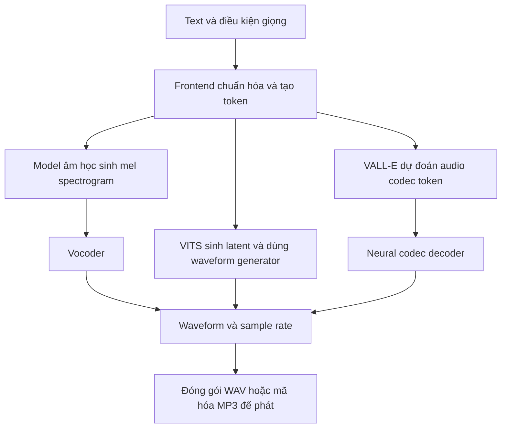

# TTS từ văn bản đến âm thanh

TTS biến nội dung cần đọc thành lời nói. Các hệ thống có thể cùng cung cấp giao diện `text → audio`, nhưng model bên trong nhận và sinh các biểu diễn khác nhau. Cần phân biệt **API dịch vụ**, **model sinh giọng** và **vocoder hoặc codec decoder** chuyển biểu diễn âm thanh thành sóng để phát.

## Các paper đã tải

| Paper và PDF local | Công bố | Nội dung nên đọc | Nguồn |
| --- | --- | --- | --- |
| [Tacotron 2](2018_shen_tacotron2.pdf) | ICASSP 2018, preprint 2017 | §2 và hình 1: text thành mel, mel thành waveform | [Google Research](https://research.google/pubs/natural-tts-synthesis-by-conditioning-wavenet-on-mel-spectrogram-predictions/) |
| [FastSpeech 2](2021_ren_fastspeech2.pdf) | ICLR 2021, preprint 2020 | §2 và hình 1: duration, pitch, energy và sinh song song | [Microsoft Research](https://www.microsoft.com/en-us/research/publication/fastspeech-2-fast-and-high-quality-end-to-end-text-to-speech/) |
| [HiFi-GAN](2020_kong_hifi_gan.pdf) | NeurIPS 2020 | §2: generator và discriminator của vocoder | [NeurIPS](https://papers.neurips.cc/paper_files/paper/2020/hash/c5d736809766d46260d816d8dbc9eb44-Abstract.html) |
| [VITS](2021_kim_vits.pdf) | ICML 2021 | §2 và hình 1: so sánh training với inference | [PMLR](https://proceedings.mlr.press/v139/kim21f.html) |
| [VALL-E](2023_wang_vall_e.pdf) | Preprint arXiv 2023 | §3: phoneme prompt, acoustic prompt và neural codec | [arXiv](https://arxiv.org/abs/2301.02111) |
| [SpeechT5](2022_ao_speecht5.pdf) | ACL 2022 | §2 và §3: kiến trúc chung và fine-tune theo tác vụ | [ACL](https://aclanthology.org/2022.acl-long.393/) |
| [F5-TTS](2025_chen_f5_tts.pdf) | ACL 2025, preprint 2024 | §3 và hình 1: flow matching, giọng mẫu và sinh mel | [ACL](https://aclanthology.org/2025.acl-long.313/) |

Bảy PDF đã kiểm tra header, tiêu đề trang đầu, số trang và SHA-256; tổng khoảng 9,34 MiB. [manifest.json](manifest.json) lưu tiêu đề đầy đủ, nguồn tải và checksum. Bản arXiv có thể chứa các sửa đổi sau ngày công bố ban đầu. Đọc theo thứ tự Tacotron 2 → HiFi-GAN → FastSpeech 2 → VITS → VALL-E → F5-TTS → SpeechT5.

## Luồng xử lý

Ví dụ cần đọc câu `I have 2 cats.`. Frontend có thể chuẩn hóa số thành `two`, rồi tokenizer chuyển chữ hoặc phoneme thành token ID. Grapheme là đơn vị chữ viết; phoneme là đơn vị âm vị. Model không nhất thiết nhận nguyên chuỗi ký tự mà API nhận. Tacotron 2 dùng biểu diễn từ ký tự; FastSpeech 2 dùng chuỗi phoneme trong thí nghiệm gốc. [Tacotron 2](https://arxiv.org/pdf/1712.05884), [FastSpeech 2](https://arxiv.org/pdf/2006.04558)



Sơ đồ đối chiếu ba kiểu kiến trúc, không phải các bước bắt buộc của mọi model. Tacotron 2 thuộc nhánh mel → vocoder; VITS có generator sinh waveform từ latent; VALL-E dùng codec token. [Tacotron 2](https://arxiv.org/pdf/1712.05884), [VITS](https://proceedings.mlr.press/v139/kim21f/kim21f.pdf), [VALL-E](https://arxiv.org/pdf/2301.02111)

Mel-spectrogram là ma trận biểu diễn năng lượng theo thời gian và các dải tần mel; nó chưa phải sóng có thể đưa trực tiếp ra loa. **HiFi-GAN** nhận mel, dùng mạng convolution để tăng độ phân giải thời gian và sinh waveform. Generator học với các discriminator đánh giá cấu trúc âm thanh ở nhiều thang và chu kỳ; khi inference chỉ cần generator. [HiFi-GAN, §2](https://papers.neurips.cc/paper/2020/file/c5d736809766d46260d816d8dbc9eb44-Paper.pdf)

Waveform là dãy giá trị biên độ. Với ví dụ mono 3 giây ở 24.000 Hz, có 72.000 mẫu. Sample rate phải đi cùng waveform; ghi sai sample rate làm thay đổi tốc độ và cao độ khi phát. WAV là định dạng chứa audio, MP3 là định dạng nén; hai tên này không mô tả kiến trúc neural network.

## Input và output theo model

| Thành phần | Input ở inference | Xử lý chính | Output để đi tiếp |
| --- | --- | --- | --- |
| Tacotron 2 | Chuỗi token ký tự | Encoder và attention decoder sinh tuần tự | Mel-spectrogram → WaveNet vocoder → waveform |
| FastSpeech 2 | Token phoneme; có thể điều khiển duration, pitch, energy | Encoder → variance adaptor → mel decoder, sinh song song | Mel → vocoder → waveform |
| HiFi-GAN | Mel-spectrogram đúng cấu hình đã học | Convolution, upsampling và residual blocks | Waveform; bản thân vocoder không đọc text |
| VITS | Phoneme, thêm speaker ID ở cấu hình nhiều người nói | Text encoder, stochastic duration predictor, flow và generator | Waveform |
| VALL-E | Phoneme prompt và acoustic prompt từ audio giọng mẫu | Language model dự đoán các tầng codec token | Codec token → codec decoder → waveform |
| F5-TTS | Text cần đọc, audio giọng mẫu và transcript của audio mẫu | ConvNeXt xử lý text; DiT và flow matching sinh mel có điều kiện | Mel → vocoder → waveform |
| SpeechT5 | Text hoặc speech tùy tác vụ và checkpoint | Pre-net theo modality → encoder–decoder chung → post-net | Text hoặc biểu diễn speech; nhánh TTS dùng thêm vocoder |

Nguồn cho các hàng tương ứng: [Tacotron 2](https://arxiv.org/pdf/1712.05884), [FastSpeech 2](https://arxiv.org/pdf/2006.04558), [HiFi-GAN](https://papers.neurips.cc/paper/2020/file/c5d736809766d46260d816d8dbc9eb44-Paper.pdf), [VITS](https://proceedings.mlr.press/v139/kim21f/kim21f.pdf), [VALL-E](https://arxiv.org/pdf/2301.02111), [F5-TTS](https://aclanthology.org/2025.acl-long.313.pdf), [SpeechT5](https://aclanthology.org/2022.acl-long.393.pdf).

FastSpeech **2s** là biến thể sinh waveform trực tiếp; phân biệt với FastSpeech **2** sinh mel. Vì vậy ngay các biến thể trong một họ model cũng có thể khác output. [FastSpeech 2](https://arxiv.org/pdf/2006.04558)

F5-TTS dùng audio mẫu để cung cấp đặc điểm giọng; transcript mẫu giúp liên kết nội dung với audio. Triển khai chính thức có `ref_audio`, `ref_text`, `gen_text`; nếu bỏ trống transcript mẫu, wrapper có thể gọi ASR để tạo nó. ASR này là bước hỗ trợ của pipeline, không có nghĩa checkpoint F5-TTS tự làm STT. [Code chính thức](https://github.com/SWivid/F5-TTS)

## Huấn luyện khác chạy suy luận

Khi train TTS có giám sát, cặp text và audio đích cung cấp nội dung cùng cách thể hiện cần học. Tại inference, audio đích chưa tồn tại. Audio tham chiếu trong voice cloning chỉ là điều kiện về giọng, không phải đáp án audio cần sinh.

FastSpeech 2 lấy duration, pitch và energy từ audio thật khi train, rồi dùng giá trị dự đoán khi inference. VITS có posterior encoder đọc spectrogram đích và discriminator trong training, nhưng bỏ hai thành phần này khỏi đường inference. Không được nhìn sơ đồ training rồi yêu cầu người dùng cung cấp mọi tensor của sơ đồ đó. [FastSpeech 2](https://arxiv.org/pdf/2006.04558), [VITS](https://proceedings.mlr.press/v139/kim21f/kim21f.pdf)

Giao diện thay thế giữa model còn phụ thuộc tokenizer, ngôn ngữ, speaker ID hoặc embedding, tensor shape, sample rate và khả năng streaming. Hai model cùng trả mel vẫn có thể dùng cấu hình mel khác nhau. Vocoder phải khớp biểu diễn mel và cấu hình đã học; không ghép chỉ dựa vào tên `mel-spectrogram`. [Hướng dẫn ghép model và vocoder của NVIDIA](https://github.com/NVIDIA/tacotron2)

## Các tác vụ ngoài đọc văn bản

Voice cloning là một cách điều kiện hóa TTS bằng giọng tham chiếu, được nghiên cứu trong VALL-E và F5-TTS. Nó khác voice conversion: chuyển đặc điểm giọng của một audio đã có. Ngôn ngữ, cảm xúc và tốc độ là các khả năng điều khiển cần được model và dữ liệu hỗ trợ, không phải chức năng mặc định của mọi TTS. [VALL-E](https://arxiv.org/pdf/2301.02111), [F5-TTS](https://aclanthology.org/2025.acl-long.313.pdf)

SpeechT5 minh họa một framework học biểu diễn chung rồi fine-tune cho các bài toán:

| Tác vụ | Input | Output |
| --- | --- | --- |
| ASR hoặc STT | Audio lời nói | Văn bản |
| TTS | Văn bản và điều kiện giọng | Speech qua nhánh sinh âm thanh |
| Speech translation trong paper | Lời nói ngôn ngữ nguồn | Văn bản ngôn ngữ đích |
| Voice conversion | Lời nói và giọng đích | Lời nói được chuyển giọng |
| Speech enhancement | Speech có nhiễu | Speech được cải thiện |
| Speaker identification | Audio | Nhãn người nói |

Các tác vụ có cách fine-tune và đường input/output riêng. Một checkpoint TTS đã tải không tự biến thành checkpoint ASR khi đổi tên hàm hoặc tham số. [SpeechT5, §2.3 và §3](https://aclanthology.org/2022.acl-long.393.pdf), [checkpoint và hướng dẫn tác giả](https://github.com/microsoft/SpeechT5/blob/main/SpeechT5/README.md)

## Áp dụng cho project MDD và ai33

Đường đi đã chọn cho project:

```text
Assessment từ model MDD
    → LLM tạo feedback JSON
    → backend kiểm tra schema và lấy tts_segments
    → chọn voice theo ngôn ngữ
    → gửi ai33 text, voice_id, speed
    → nhận task_id rồi polling
    → tải audio và đưa đường dẫn local cho UI
```

Input của API một giọng, minh họa theo tài liệu dịch vụ:

```json
{
  "text": "I think this is useful.",
  "voice_id": "VOICE_ID_TIENG_ANH_TRONG_TAI_KHOAN",
  "speed": 1
}
```

`POST /v3/text-to-speech` tạo tác vụ, `GET /v1/task/{task_id}` kiểm tra kết quả. JSON có `task_id` là output của lớp điều phối dịch vụ; file audio tải về mới là sản phẩm lời nói. Public API mô tả giao diện, không xác định ai33 đang chạy kiến trúc nào trong các paper trên. [Tài liệu API](https://openspeaker.ai/developers), [public OpenAPI](https://openspeaker.ai/openapi-generation.json)

Adapter hiện tại [ai33_tts.py](../../scripts/ai33_tts.py) trả một `Path` trỏ đến audio đã tải/cache; backend còn giữ locale, voice và task ID trong receipt. Đây là quy ước của project, không phải chuẩn input/output chung cho mọi TTS. Câu mẫu tiếng Anh dùng giọng Anh; giải thích tiếng Việt dùng giọng Việt. TTS tạo lời nói để nghe mẫu; model MDD vẫn là thành phần đánh giá audio người học.

## Kiểm tra lại các PDF

```bash
python3 scripts/download_tts_papers.py --verify-only
```

Lệnh kiểm tra PDF local với manifest, không gọi API TTS và không tải model. Chạy không có `--verify-only` để tải các PDF còn thiếu. Script cần `pdfinfo` và `pdftotext` có trên máy hiện tại. Dataset L2-ARCTIC được ignore riêng; các PDF và tài liệu trong `papers/` được giữ cho Git.
